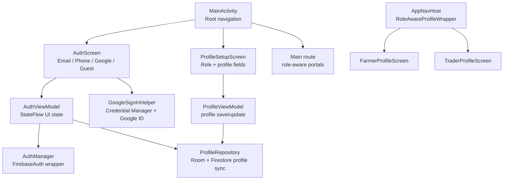
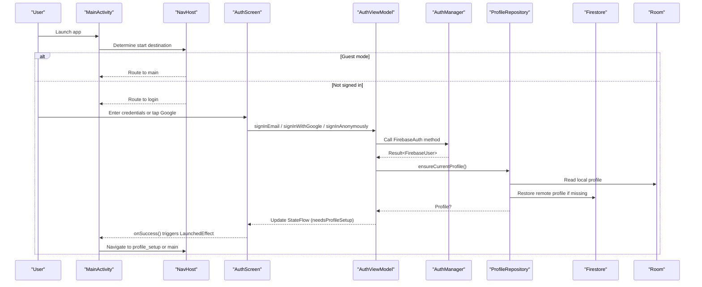
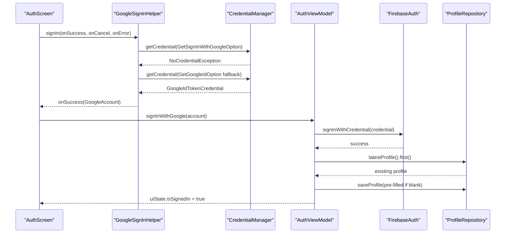
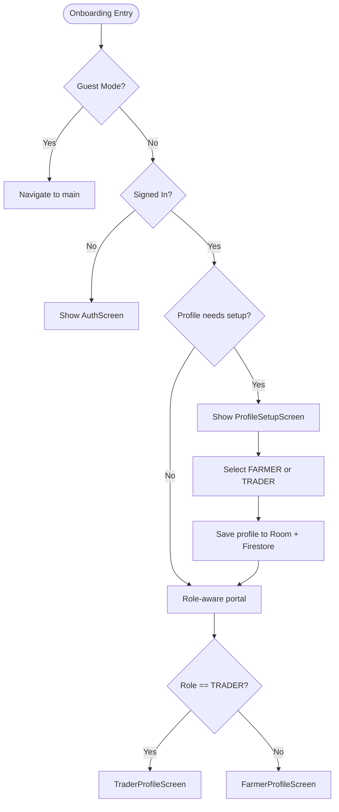
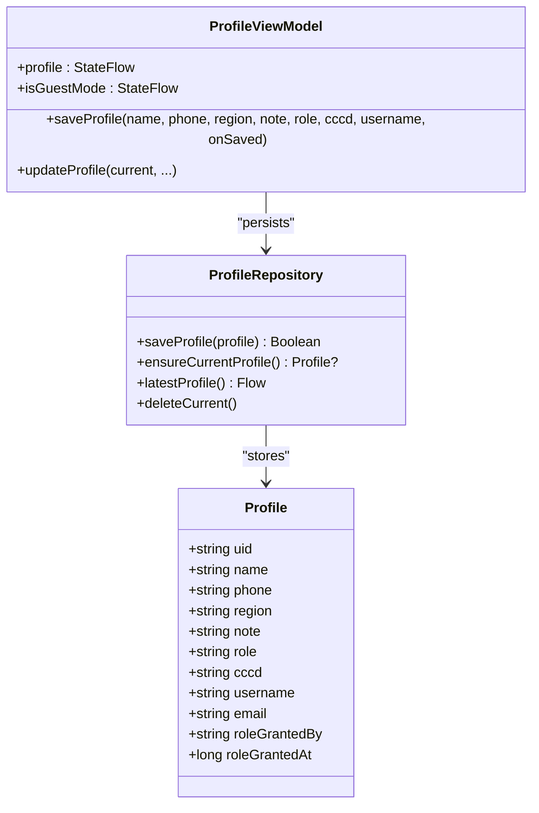
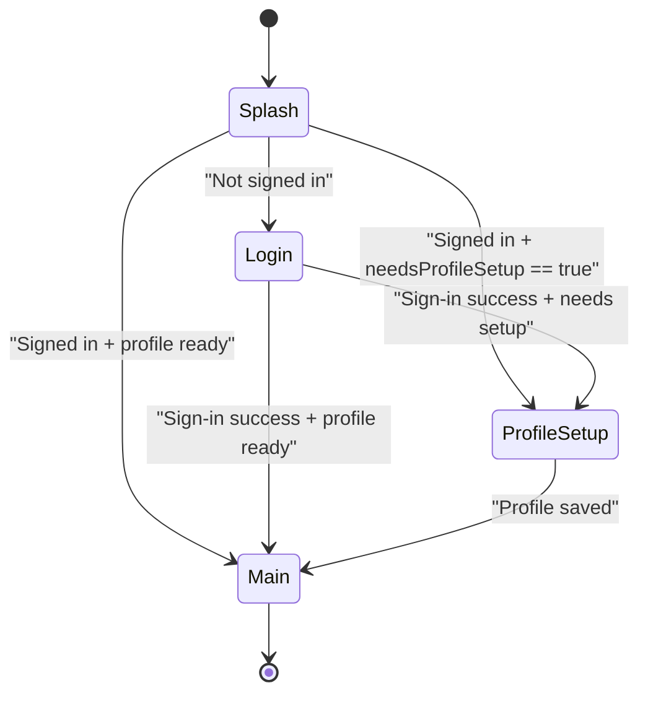
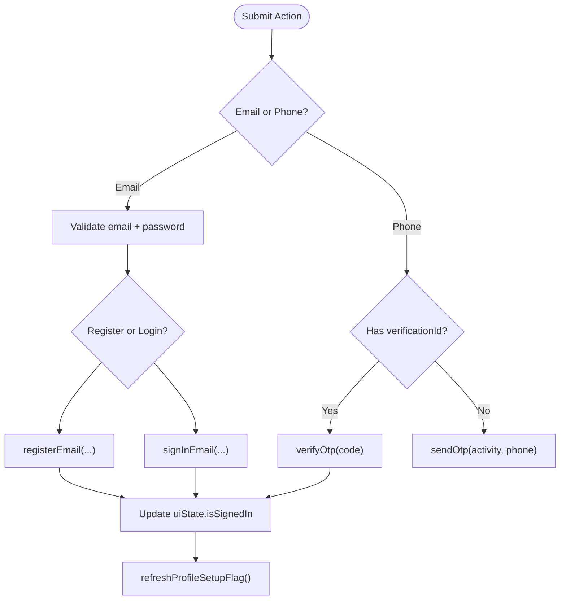
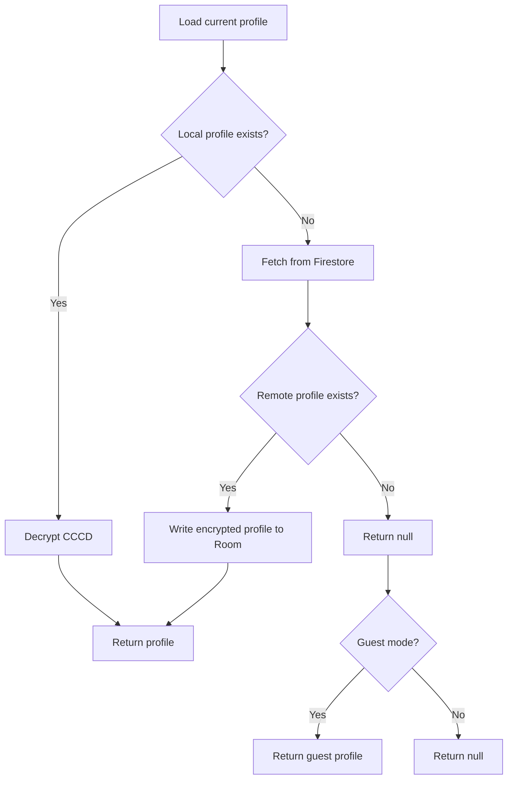
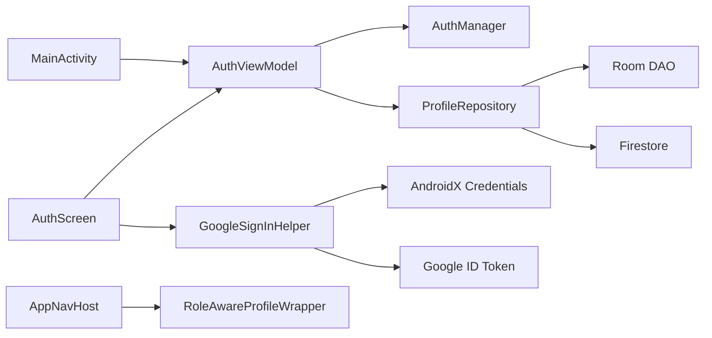

# Authentication & Onboarding Screens

<cite>
**Referenced Files in This Document**   
- [MainActivity.kt](file://app/src/main/java/com/giathinh/canlua/MainActivity.kt)
- [AuthScreen.kt](file://app/src/main/java/com/giathinh/canlua/ui/screen/AuthScreen.kt)
- [ProfileSetupScreen.kt](file://app/src/main/java/com/giathinh/canlua/ui/screen/ProfileSetupScreen.kt)
- [AppNavHost.kt](file://app/src/main/java/com/giathinh/canlua/ui/navigation/AppNavHost.kt)
- [FarmerProfileScreen.kt](file://app/src/main/java/com/giathinh/canlua/ui/screen/FarmerProfileScreen.kt)
- [AuthViewModel.kt](file://app/src/main/java/com/giathinh/canlua/ui/viewmodel/AuthViewModel.kt)
- [ProfileViewModel.kt](file://app/src/main/java/com/giathinh/canlua/ui/viewmodel/ProfileViewModel.kt)
- [GoogleSignInHelper.kt](file://app/src/main/java/com/giathinh/canlua/auth/GoogleSignInHelper.kt)
- [AuthManager.kt](file://app/src/main/java/com/giathinh/canlua/repository/AuthManager.kt)
- [ProfileRepository.kt](file://app/src/main/java/com/giathinh/canlua/repository/ProfileRepository.kt)
- [Profile.kt](file://app/src/main/java/com/giathinh/canlua/data/model/Profile.kt)
</cite>

## Table of Contents
1. [Introduction](#introduction)
2. [Project Structure](#project-structure)
3. [Core Components](#core-components)
4. [Architecture Overview](#architecture-overview)
5. [Detailed Component Analysis](#detailed-component-analysis)
6. [Dependency Analysis](#dependency-analysis)
7. [Performance Considerations](#performance-considerations)
8. [Troubleshooting Guide](#troubleshooting-guide)
9. [Conclusion](#conclusion)

## Introduction
This document explains the authentication and onboarding implementation for Cân Lúa Mobile, focusing on Google Sign-In, role-based onboarding for FARMER, TRADER, and GUEST, profile setup with validation, session management, and offline-first behavior. The app follows Kotlin 2.3, Jetpack Compose, MVVM, and Clean Architecture with unidirectional data flow through StateFlow and coroutines. Local persistence uses AndroidX Room; cloud sync is bidirectional to Firebase Firestore and Supabase via WorkManager. AI features run through OpenRouter with RAG context from local knowledge JSON files.

## Project Structure
The authentication and onboarding flow spans UI screens, ViewModels, a repository layer, and an auth manager:

**Diagram sources**
- [MainActivity.kt:34-141](file://app/src/main/java/com/giathinh/canlua/MainActivity.kt#L34-L141)
- [AuthScreen.kt:114-335](file://app/src/main/java/com/giathinh/canlua/ui/screen/AuthScreen.kt#L114-L335)
- [ProfileSetupScreen.kt:38-225](file://app/src/main/java/com/giathinh/canlua/ui/screen/ProfileSetupScreen.kt#L38-L225)
- [AuthViewModel.kt:39-94](file://app/src/main/java/com/giathinh/canlua/ui/viewmodel/AuthViewModel.kt#L39-L94)
- [AuthManager.kt:12-35](file://app/src/main/java/com/giathinh/canlua/repository/AuthManager.kt#L12-L35)
- [ProfileRepository.kt:27-109](file://app/src/main/java/com/giathinh/canlua/repository/ProfileRepository.kt#L27-L109)
- [ProfileViewModel.kt:18-76](file://app/src/main/java/com/giathinh/canlua/ui/viewmodel/ProfileViewModel.kt#L18-L76)
- [GoogleSignInHelper.kt:39-100](file://app/src/main/java/com/giathinh/canlua/auth/GoogleSignInHelper.kt#L39-L100)
- [AppNavHost.kt:139-150](file://app/src/main/java/com/giathinh/canlua/ui/navigation/AppNavHost.kt#L139-L150)
- [FarmerProfileScreen.kt:86-121](file://app/src/main/java/com/giathinh/canlua/ui/screen/FarmerProfileScreen.kt#L86-L121)

**Section sources**
- [MainActivity.kt:34-141](file://app/src/main/java/com/giathinh/canlua/MainActivity.kt#L34-L141)
- [AppNavHost.kt:27-150](file://app/src/main/java/com/giathinh/canlua/ui/navigation/AppNavHost.kt#L27-L150)

## Core Components
- **AuthScreen**: Compose screen handling email/password, phone OTP, Google Sign-In, and guest mode. It validates inputs locally, shows snackbar feedback, and delegates business logic to `AuthViewModel`.
- **AuthViewModel**: Central auth state holder using `StateFlow<AuthUiState>`. It subscribes to `AuthManager.authStateFlow`, manages sign-in flows (email, anonymous, Google, phone OTP), pre-fills profile data when needed, and decides whether profile setup is required.
- **GoogleSignInHelper**: Modern Credential Manager integration replacing legacy Google Sign-In. It checks network availability, tries `GetSignInWithGoogleOption`, falls back to `GetGoogleIdOption`, extracts `GoogleAccount` with idToken and profile fields, and humanizes errors.
- **AuthManager**: Singleton wrapping `FirebaseAuth`. Exposes `currentUser`, `isAuthenticated`, `authStateFlow`, and suspend functions for anonymous/email sign-in and user creation.
- **ProfileRepository**: UID-scoped profile storage keyed by Firebase UID. It saves encrypted profiles locally to Room, mirrors to Firestore, restores remote profiles into Room, and streams the current user’s profile.
- **ProfileSetupScreen**: Role selection (FARMER/TRADER/STAFF enum) plus name, phone, region, and CCCD fields. Saves via `ProfileViewModel.saveProfile`, then navigates or calls completion callback.
- **ProfileViewModel**: Exposes reactive profile stream, guest mode state, and methods to create or update profiles.
- **AppNavHost + RoleAwareProfileWrapper**: Routes account/profile tabs to either `FarmerProfileScreen` or `TraderProfileScreen` based on profile role.
- **MainActivity**: Root navigation orchestrator that chooses between splash, login, profile setup, and main routes based on guest mode, signed-in state, and profile setup flag.

**Section sources**
- [AuthScreen.kt:114-335](file://app/src/main/java/com/giathinh/canlua/ui/screen/AuthScreen.kt#L114-L335)
- [AuthViewModel.kt:25-94](file://app/src/main/java/com/giathinh/canlua/ui/viewmodel/AuthViewModel.kt#L25-L94)
- [GoogleSignInHelper.kt:23-100](file://app/src/main/java/com/giathinh/canlua/auth/GoogleSignInHelper.kt#L23-L100)
- [AuthManager.kt:12-72](file://app/src/main/java/com/giathinh/canlua/repository/AuthManager.kt#L12-L72)
- [ProfileRepository.kt:27-109](file://app/src/main/java/com/giathinh/canlua/repository/ProfileRepository.kt#L27-L109)
- [ProfileSetupScreen.kt:36-225](file://app/src/main/java/com/giathinh/canlua/ui/screen/ProfileSetupScreen.kt#L36-L225)
- [ProfileViewModel.kt:18-76](file://app/src/main/java/com/giathinh/canlua/ui/viewmodel/ProfileViewModel.kt#L18-L76)
- [AppNavHost.kt:139-150](file://app/src/main/java/com/giathinh/canlua/ui/navigation/AppNavHost.kt#L139-L150)
- [MainActivity.kt:34-141](file://app/src/main/java/com/giathinh/canlua/MainActivity.kt#L34-L141)

## Architecture Overview
The app uses MVVM with unidirectional data flow:

**Diagram sources**
- [MainActivity.kt:74-141](file://app/src/main/java/com/giathinh/canlua/MainActivity.kt#L74-L141)
- [AuthScreen.kt:114-335](file://app/src/main/java/com/giathinh/canlua/ui/screen/AuthScreen.kt#L114-L335)
- [AuthViewModel.kt:46-94](file://app/src/main/java/com/giathinh/canlua/ui/viewmodel/AuthViewModel.kt#L46-L94)
- [AuthManager.kt:22-35](file://app/src/main/java/com/giathinh/canlua/repository/AuthManager.kt#L22-L35)
- [ProfileRepository.kt:50-84](file://app/src/main/java/com/giathinh/canlua/repository/ProfileRepository.kt#L50-L84)

## Detailed Component Analysis

### Google Sign-In Integration Flow
`AuthScreen` renders a Google button that invokes `GoogleSignInHelper.signIn`. The helper:
- Checks network connectivity before opening the credential picker.
- Tries `GetSignInWithGoogleOption` first.
- Falls back to `GetGoogleIdOption` with `filterByAuthorizedAccounts = false` when no credential is available.
- Extracts `GoogleAccount` containing idToken, email, displayName, phoneNumber, and photoUri.
- Humanizes errors for developer configuration issues, network failures, cancellation, and unknown exceptions.

`AuthViewModel.signInWithGoogle`:
- Converts the idToken to a Firebase credential.
- Signs in via `FirebaseAuth`.
- Pre-fills local profile only if the existing profile has a blank name.
- Updates `AuthUiState.isSignedIn` and refreshes `needsProfileSetup`.

**Diagram sources**
- [AuthScreen.kt:263-276](file://app/src/main/java/com/giathinh/canlua/ui/screen/AuthScreen.kt#L263-L276)
- [GoogleSignInHelper.kt:44-100](file://app/src/main/java/com/giathinh/canlua/auth/GoogleSignInHelper.kt#L44-L100)
- [GoogleSignInHelper.kt:102-145](file://app/src/main/java/com/giathinh/canlua/auth/GoogleSignInHelper.kt#L102-L145)
- [GoogleSignInHelper.kt:147-161](file://app/src/main/java/com/giathinh/canlua/auth/GoogleSignInHelper.kt#L147-L161)
- [AuthViewModel.kt:199-229](file://app/src/main/java/com/giathinh/canlua/ui/viewmodel/AuthViewModel.kt#L199-L229)

**Section sources**
- [AuthScreen.kt:263-276](file://app/src/main/java/com/giathinh/canlua/ui/screen/AuthScreen.kt#L263-L276)
- [GoogleSignInHelper.kt:39-100](file://app/src/main/java/com/giathinh/canlua/auth/GoogleSignInHelper.kt#L39-L100)
- [GoogleSignInHelper.kt:102-174](file://app/src/main/java/com/giathinh/canlua/auth/GoogleSignInHelper.kt#L102-L174)
- [AuthViewModel.kt:199-229](file://app/src/main/java/com/giathinh/canlua/ui/viewmodel/AuthViewModel.kt#L199-L229)

### Role-Based Onboarding (FARMER, TRADER, GUEST)
- **FARMER**: Default role used during email registration and Google pre-fill. The farmer portal is rendered by `FarmerProfileScreen`.
- **TRADER**: Selected in `ProfileSetupScreen`; the account/profile tab routes to `TraderProfileScreen` via `RoleAwareProfileWrapper`.
- **GUEST**: When the user taps “Skip login”, `MainActivity` sets guest mode and routes directly to the main application without requiring authentication.

**Diagram sources**
- [MainActivity.kt:79-108](file://app/src/main/java/com/giathinh/canlua/MainActivity.kt#L79-L108)
- [ProfileSetupScreen.kt:36-225](file://app/src/main/java/com/giathinh/canlua/ui/screen/ProfileSetupScreen.kt#L36-L225)
- [AppNavHost.kt:139-150](file://app/src/main/java/com/giathinh/canlua/ui/navigation/AppNavHost.kt#L139-L150)
- [FarmerProfileScreen.kt:86-121](file://app/src/main/java/com/giathinh/canlua/ui/screen/FarmerProfileScreen.kt#L86-L121)

**Section sources**
- [MainActivity.kt:79-108](file://app/src/main/java/com/giathinh/canlua/MainActivity.kt#L79-L108)
- [ProfileSetupScreen.kt:36-225](file://app/src/main/java/com/giathinh/canlua/ui/screen/ProfileSetupScreen.kt#L36-L225)
- [AppNavHost.kt:139-150](file://app/src/main/java/com/giathinh/canlua/ui/navigation/AppNavHost.kt#L139-L150)

### Profile Setup Validation and Persistence
`ProfileSetupScreen` collects:
- Name (required to enable submit).
- Phone.
- Region.
- CCCD.
- Role (enum `UserRole.FARMER`, `TRADER`, `STAFF`).

It calls `ProfileViewModel.saveProfile`, which constructs a `Profile` entity and persists it via `ProfileRepository.saveProfile`. The repository:
- Assigns the current Firebase UID if blank.
- Encrypts CCCD using `CccdCrypto`.
- Inserts into Room.
- Mirrors to Firestore collection `profiles`.

**Diagram sources**
- [Profile.kt:13-26](file://app/src/main/java/com/giathinh/canlua/data/model/Profile.kt#L13-L26)
- [ProfileViewModel.kt:51-76](file://app/src/main/java/com/giathinh/canlua/ui/viewmodel/ProfileViewModel.kt#L51-L76)
- [ProfileRepository.kt:37-48](file://app/src/main/java/com/giathinh/canlua/repository/ProfileRepository.kt#L37-L48)

**Section sources**
- [ProfileSetupScreen.kt:134-220](file://app/src/main/java/com/giathinh/canlua/ui/screen/ProfileSetupScreen.kt#L134-L220)
- [ProfileViewModel.kt:51-76](file://app/src/main/java/com/giathinh/canlua/ui/viewmodel/ProfileViewModel.kt#L51-L76)
- [ProfileRepository.kt:37-48](file://app/src/main/java/com/giathinh/canlua/repository/ProfileRepository.kt#L37-L48)
- [Profile.kt:13-26](file://app/src/main/java/com/giathinh/canlua/data/model/Profile.kt#L13-L26)

### Session Management and Navigation
`AuthViewModel` maintains `AuthUiState` with:
- `isSignedIn`: reflects current auth status.
- `loading`: indicates ongoing operations.
- `error` / `info`: user-facing messages.
- `userLabel`: display identity derived from email, phone, or UID.
- `verificationId`: temporary OTP verification state.
- `needsProfileSetup`: null while loading, true if profile requires setup, false otherwise.

`MainActivity` determines root navigation:
- Guest mode → main.
- Not signed in → login.
- Signed in but profile setup pending → profile setup.
- Otherwise → main.

**Diagram sources**
- [AuthViewModel.kt:25-37](file://app/src/main/java/com/giathinh/canlua/ui/viewmodel/AuthViewModel.kt#L25-L37)
- [MainActivity.kt:79-108](file://app/src/main/java/com/giathinh/canlua/MainActivity.kt#L79-L108)

**Section sources**
- [AuthViewModel.kt:46-94](file://app/src/main/java/com/giathinh/canlua/ui/viewmodel/AuthViewModel.kt#L46-L94)
- [MainActivity.kt:74-141](file://app/src/main/java/com/giathinh/canlua/MainActivity.kt#L74-L141)

### Email and Phone OTP Flows
`AuthScreen` supports:
- Email/password register/sign-in with regex validation and minimum password length.
- Phone number detection via `AuthViewModel.looksLikePhone`.
- OTP send/verify using Firebase Phone Auth callbacks exposed through `AuthViewModel.sendOtp` and `verifyOtp`.

**Diagram sources**
- [AuthScreen.kt:387-459](file://app/src/main/java/com/giathinh/canlua/ui/screen/AuthScreen.kt#L387-L459)
- [AuthScreen.kt:744-755](file://app/src/main/java/com/giathinh/canlua/ui/screen/AuthScreen.kt#L744-L755)
- [AuthViewModel.kt:109-131](file://app/src/main/java/com/giathinh/canlua/ui/viewmodel/AuthViewModel.kt#L109-L131)
- [AuthViewModel.kt:133-175](file://app/src/main/java/com/giathinh/canlua/ui/viewmodel/AuthViewModel.kt#L133-L175)
- [AuthViewModel.kt:231-289](file://app/src/main/java/com/giathinh/canlua/ui/viewmodel/AuthViewModel.kt#L231-L289)

**Section sources**
- [AuthScreen.kt:387-459](file://app/src/main/java/com/giathinh/canlua/ui/screen/AuthScreen.kt#L387-L459)
- [AuthScreen.kt:744-755](file://app/src/main/java/com/giathinh/canlua/ui/screen/AuthScreen.kt#L744-L755)
- [AuthViewModel.kt:109-175](file://app/src/main/java/com/giathinh/canlua/ui/viewmodel/AuthViewModel.kt#L109-L175)
- [AuthViewModel.kt:231-289](file://app/src/main/java/com/giathinh/canlua/ui/viewmodel/AuthViewModel.kt#L231-L289)

### Offline-First Authentication Strategy
- Local Room database stores profiles keyed by Firebase UID.
- `ProfileRepository.ensureCurrentProfile` reads local profile first; if missing, it attempts to restore from Firestore and writes it back to Room.
- `ProfileRepository.latestProfile` streams the current user’s profile, switching automatically when auth state changes.
- If no authenticated user exists, guest mode returns a synthetic guest profile so the app remains usable offline.
- Network checks in `GoogleSignInHelper` prevent misleading error messages when there is no internet connection.

**Diagram sources**
- [ProfileRepository.kt:50-109](file://app/src/main/java/com/giathinh/canlua/repository/ProfileRepository.kt#L50-L109)
- [GoogleSignInHelper.kt:176-185](file://app/src/main/java/com/giathinh/canlua/auth/GoogleSignInHelper.kt#L176-L185)

**Section sources**
- [ProfileRepository.kt:50-109](file://app/src/main/java/com/giathinh/canlua/repository/ProfileRepository.kt#L50-L109)
- [GoogleSignInHelper.kt:44-54](file://app/src/main/java/com/giathinh/canlua/auth/GoogleSignInHelper.kt#L44-L54)

### Security Considerations
- CCCD is encrypted before storing in Room and decrypted when read.
- Profiles are scoped by Firebase UID to avoid cross-user data leakage on shared devices.
- Google Sign-In uses modern Credential Manager and Google Identity APIs rather than legacy Google Sign-In.
- Error messages are localized and do not expose raw stack traces to users.
- Anonymous sign-in is supported but does not pre-fill profile unless explicitly saved.

**Section sources**
- [ProfileRepository.kt:37-48](file://app/src/main/java/com/giathinh/canlua/repository/ProfileRepository.kt#L37-L48)
- [ProfileRepository.kt:50-84](file://app/src/main/java/com/giathinh/canlua/repository/ProfileRepository.kt#L50-L84)
- [GoogleSignInHelper.kt:35-43](file://app/src/main/java/com/giathinh/canlua/auth/GoogleSignInHelper.kt#L35-L43)
- [AuthViewModel.kt:177-193](file://app/src/main/java/com/giathinh/canlua/ui/viewmodel/AuthViewModel.kt#L177-L193)

## Dependency Analysis
The authentication subsystem depends on Firebase Auth, Room, Firestore, and Google Identity APIs:

**Diagram sources**
- [AuthScreen.kt:114-335](file://app/src/main/java/com/giathinh/canlua/ui/screen/AuthScreen.kt#L114-L335)
- [AuthViewModel.kt:39-94](file://app/src/main/java/com/giathinh/canlua/ui/viewmodel/AuthViewModel.kt#L39-L94)
- [AuthManager.kt:12-35](file://app/src/main/java/com/giathinh/canlua/repository/AuthManager.kt#L12-L35)
- [ProfileRepository.kt:27-109](file://app/src/main/java/com/giathinh/canlua/repository/ProfileRepository.kt#L27-L109)
- [GoogleSignInHelper.kt:39-100](file://app/src/main/java/com/giathinh/canlua/auth/GoogleSignInHelper.kt#L39-L100)
- [AppNavHost.kt:139-150](file://app/src/main/java/com/giathinh/canlua/ui/navigation/AppNavHost.kt#L139-L150)

**Section sources**
- [AuthViewModel.kt:39-94](file://app/src/main/java/com/giathinh/canlua/ui/viewmodel/AuthViewModel.kt#L39-L94)
- [ProfileRepository.kt:27-109](file://app/src/main/java/com/giathinh/canlua/repository/ProfileRepository.kt#L27-L109)
- [GoogleSignInHelper.kt:39-100](file://app/src/main/java/com/giathinh/canlua/auth/GoogleSignInHelper.kt#L39-L100)

## Performance Considerations
- `AuthViewModel` subscribes once to `AuthManager.authStateFlow` and updates a single `StateFlow` to minimize recompositions.
- `ProfileRepository.latestProfile` uses `flatMapLatest` over auth UID to switch profile streams efficiently.
- `GoogleSignInHelper` performs early network checks to avoid unnecessary credential picker overhead.
- Profile encryption/decryption occurs at repository boundaries to keep UI code simple.

[No sources needed since this section provides general guidance]

## Troubleshooting Guide
Common authentication issues and their likely causes:

- **Google Sign-In fails with developer error**: Usually caused by misconfigured client ID or SHA-1 settings. `GoogleSignInHelper.humanizeError` maps developer errors to localized messages.
- **Network error during Google Sign-In**: `GoogleSignInHelper.isNetworkAvailable` detects no internet and surfaces a clear message instead of obscure credential errors.
- **OTP not received or invalid**: `AuthViewModel.sendOtp` normalizes phone numbers and validates format; `verifyOtp` uses stored verificationId. Ensure activity is not finishing/destroyed when sending OTP.
- **Profile not appearing after sign-in**: `AuthViewModel.refreshProfileSetupFlag` calls `ProfileRepository.ensureCurrentProfile`, which restores from Firestore if local data is missing.
- **Guest mode not working**: `MainActivity` sets guest mode via `settingsViewModel.setGuestMode(true)` when skipping login; verify settings persistence and initial destination logic.

**Section sources**
- [GoogleSignInHelper.kt:163-174](file://app/src/main/java/com/giathinh/canlua/auth/GoogleSignInHelper.kt#L163-L174)
- [GoogleSignInHelper.kt:176-185](file://app/src/main/java/com/giathinh/canlua/auth/GoogleSignInHelper.kt#L176-L185)
- [AuthViewModel.kt:231-289](file://app/src/main/java/com/giathinh/canlua/ui/viewmodel/AuthViewModel.kt#L231-L289)
- [AuthViewModel.kt:85-94](file://app/src/main/java/com/giathinh/canlua/ui/viewmodel/AuthViewModel.kt#L85-L94)
- [MainActivity.kt:118-123](file://app/src/main/java/com/giathinh/canlua/MainActivity.kt#L118-L123)

## Conclusion
Cân Lúa Mobile’s authentication and onboarding system combines modern Google Sign-In, robust email/phone flows, role-based onboarding, and offline-first profile persistence. `AuthViewModel` centralizes state and orchestration, `AuthManager` abstracts Firebase Auth, and `ProfileRepository` ensures UID-scoped, encrypted, and synced profiles. `MainActivity` and `AppNavHost` coordinate navigation across splash, login, profile setup, and role-aware portals. For extending authentication providers, follow the pattern established by `GoogleSignInHelper` and `AuthViewModel.signInWithGoogle`, ensuring proper error handling, network checks, and profile pre-fill strategies.