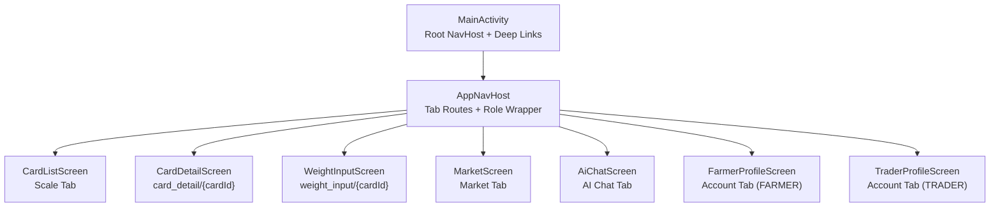
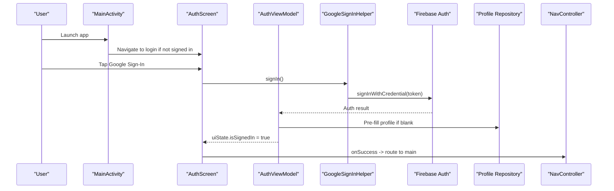
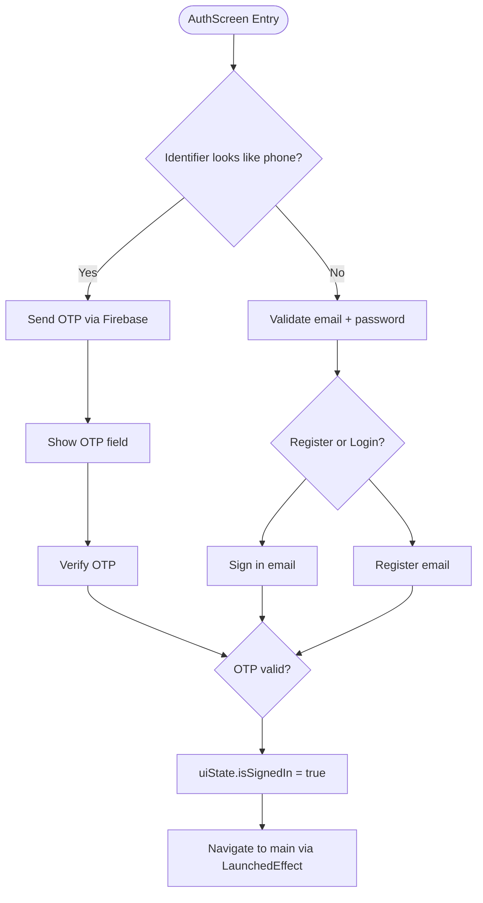
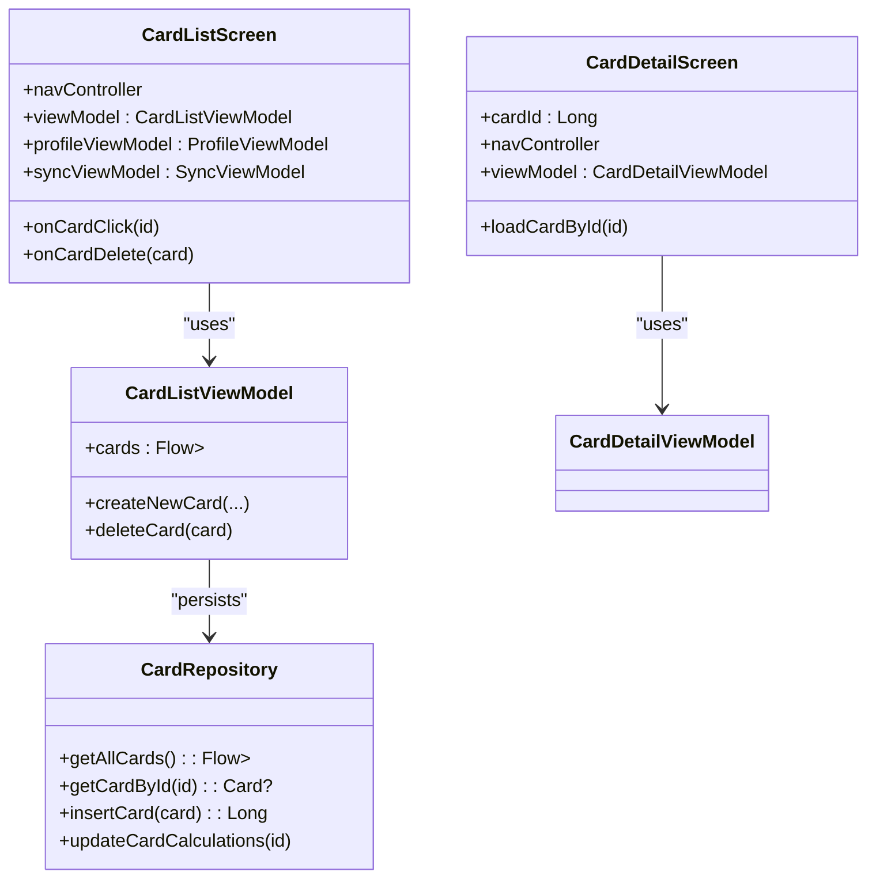
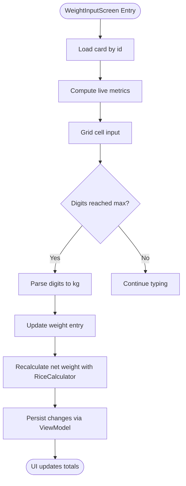
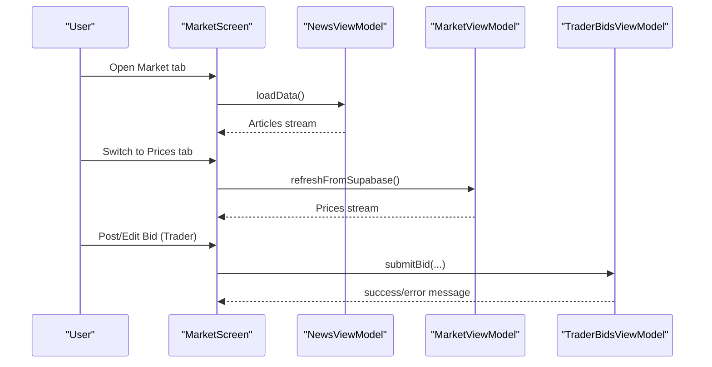
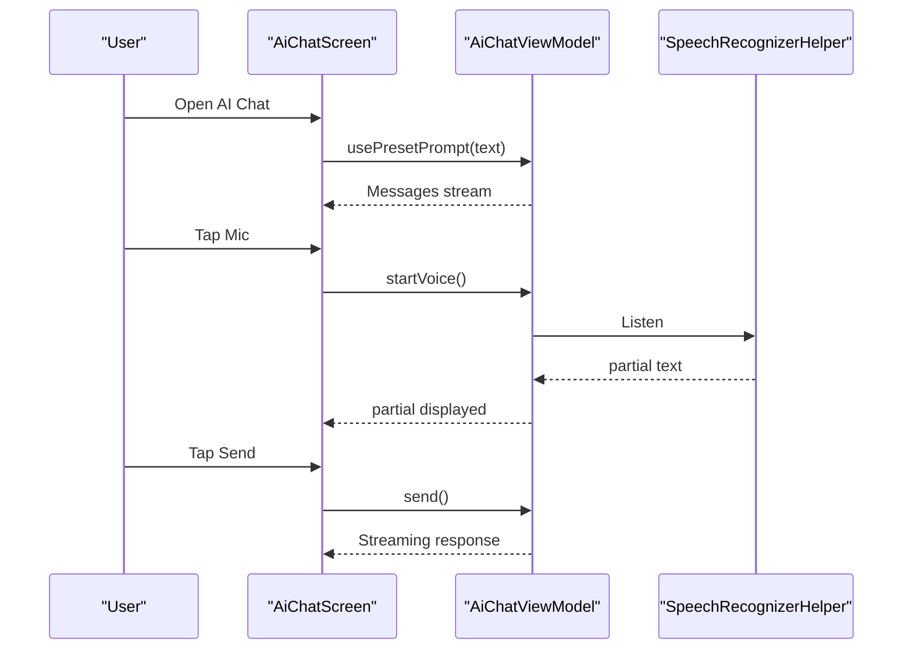
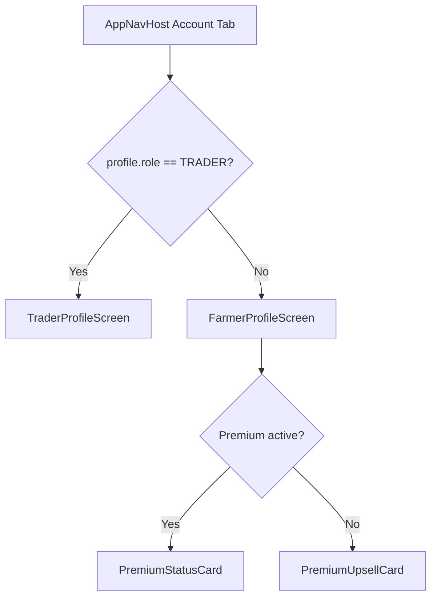
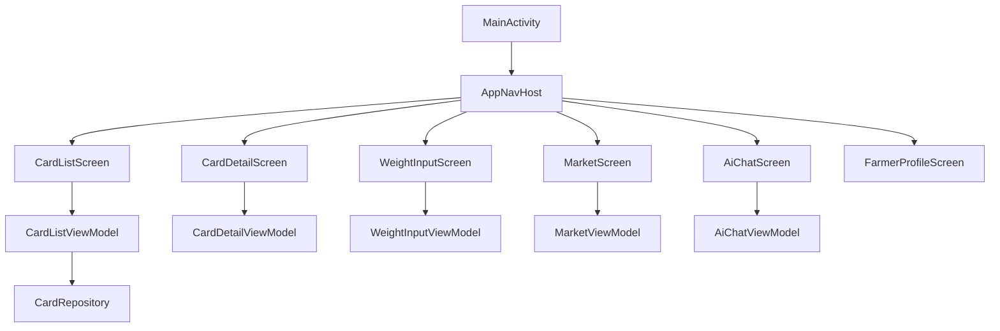

# Screen Implementations

<cite>
**Referenced Files in This Document**
- [MainActivity.kt](file://app/src/main/java/com/giathinh/canlua/MainActivity.kt)
- [AppNavHost.kt](file://app/src/main/java/com/giathinh/canlua/ui/navigation/AppNavHost.kt)
- [AuthScreen.kt](file://app/src/main/java/com/giathinh/canlua/ui/screen/AuthScreen.kt)
- [CardListScreen.kt](file://app/src/main/java/com/giathinh/canlua/ui/screen/CardListScreen.kt)
- [CardDetailScreen.kt](file://app/src/main/java/com/giathinh/canlua/ui/screen/CardDetailScreen.kt)
- [WeightInputScreen.kt](file://app/src/main/java/com/giathinh/canlua/ui/screen/WeightInputScreen.kt)
- [MarketScreen.kt](file://app/src/main/java/com/giathinh/canlua/ui/screen/market/MarketScreen.kt)
- [AiChatScreen.kt](file://app/src/main/java/com/giathinh/canlua/ui/screen/aichat/AiChatScreen.kt)
- [FarmerProfileScreen.kt](file://app/src/main/java/com/giathinh/canlua/ui/screen/FarmerProfileScreen.kt)
- [GoogleSignInHelper.kt](file://app/src/main/java/com/giathinh/canlua/auth/GoogleSignInHelper.kt)
- [AuthViewModel.kt](file://app/src/main/java/com/giathinh/canlua/ui/viewmodel/AuthViewModel.kt)
- [CardListViewModel.kt](file://app/src/main/java/com/giathinh/canlua/ui/viewmodel/CardListViewModel.kt)
- [CardRepository.kt](file://app/src/main/java/com/giathinh/canlua/repository/CardRepository.kt)
- [Card.kt](file://app/src/main/java/com/giathinh/canlua/data/model/Card.kt)
- [WeightInputUiState.kt](file://app/src/main/java/com/giathinh/canlua/ui/viewmodel/WeightInputUiState.kt)
</cite>

## Table of Contents
1. [Introduction](#introduction)
2. [Project Structure](#project-structure)
3. [Core Components](#core-components)
4. [Architecture Overview](#architecture-overview)
5. [Detailed Component Analysis](#detailed-component-analysis)
6. [Dependency Analysis](#dependency-analysis)
7. [Performance Considerations](#performance-considerations)
8. [Troubleshooting Guide](#troubleshooting-guide)
9. [Conclusion](#conclusion)
10. [Appendices](#appendices)

## Introduction
This document explains the screen implementations for Cân Lúa Mobile, covering authentication flows, card management list and detail views, agricultural weight input with specialized inputs, market intelligence with real-time data visualization, AI chat with streaming responses, and role-specific portals for farmers, traders, and guests. It also documents MVVM state management, navigation with deep linking, data binding patterns, user interaction flows, form validation, error handling, offline-first UI patterns, and guidelines for creating new screens following MVVM architecture with consistent UX.

## Project Structure
The app uses a Kotlin 2.3 / Jetpack Compose offline-first Android architecture with MVVM and Clean Architecture. The root activity manages initial routing, splash behavior, language/theme settings, and deep links into the main application. Inside the main navigation host, four primary tabs are registered: Scale (cards), Market, AI Chat, and Account. Role-aware routing selects between farmer and trader profile screens.

**Diagram sources**
- [MainActivity.kt:34-141](file://app/src/main/java/com/giathinh/canlua/MainActivity.kt#L34-L141)
- [AppNavHost.kt:31-136](file://app/src/main/java/com/giathinh/canlua/ui/navigation/AppNavHost.kt#L31-L136)

**Section sources**
- [MainActivity.kt:34-141](file://app/src/main/java/com/giathinh/canlua/MainActivity.kt#L34-L141)
- [AppNavHost.kt:31-136](file://app/src/main/java/com/giathinh/canlua/ui/navigation/AppNavHost.kt#L31-L136)

## Core Components
- Authentication flow: Email/password or phone OTP plus Google Sign-In; guest mode support; pre-fill profile on first sign-in.
- Card management: List view with filters, pull-to-refresh, delete confirmation, premium gating; detail view with financial summary and bag entries.
- Weight input: Specialized agricultural inputs including bag sampling, impurity percent, moisture conversion, locked editing, and multi-table grid entry.
- Market intelligence: News feed and rice price cards with trend filters, variety selection, bid editor for traders, native ads, and skeleton states.
- AI chat: Streaming assistant messages, voice input, preset prompts, markdown rendering, and guest-mode lock screen.
- Role portals: Farmer dashboard with KPIs, season comparison, AI insights, and premium upsell; trader profile and transaction routes.

**Section sources**
- [AuthScreen.kt:114-335](file://app/src/main/java/com/giathinh/canlua/ui/screen/AuthScreen.kt#L114-L335)
- [CardListScreen.kt:98-480](file://app/src/main/java/com/giathinh/canlua/ui/screen/CardListScreen.kt#L98-L480)
- [CardDetailScreen.kt:88-506](file://app/src/main/java/com/giathinh/canlua/ui/screen/CardDetailScreen.kt#L88-L506)
- [WeightInputScreen.kt:58-557](file://app/src/main/java/com/giathinh/canlua/ui/screen/WeightInputScreen.kt#L58-L557)
- [MarketScreen.kt:104-388](file://app/src/main/java/com/giathinh/canlua/ui/screen/market/MarketScreen.kt#L104-L388)
- [AiChatScreen.kt:101-205](file://app/src/main/java/com/giathinh/canlua/ui/screen/aichat/AiChatScreen.kt#L101-L205)
- [FarmerProfileScreen.kt:86-279](file://app/src/main/java/com/giathinh/canlua/ui/screen/FarmerProfileScreen.kt#L86-L279)

## Architecture Overview
The UI layer follows MVVM: each screen composes a ViewModel via Hilt, collects StateFlow using collectAsStateWithLifecycle, and triggers actions that update local Room data and sync to Firestore/Supabase. Navigation is centralized in AppNavHost with consistent transitions and deep link support from MainActivity.

**Diagram sources**
- [MainActivity.kt:118-123](file://app/src/main/java/com/giathinh/canlua/MainActivity.kt#L118-L123)
- [AuthScreen.kt:263-276](file://app/src/main/java/com/giathinh/canlua/ui/screen/AuthScreen.kt#L263-L276)
- [GoogleSignInHelper.kt:44-63](file://app/src/main/java/com/giathinh/canlua/auth/GoogleSignInHelper.kt#L44-L63)
- [AuthViewModel.kt:199-206](file://app/src/main/java/com/giathinh/canlua/ui/viewmodel/AuthViewModel.kt#L199-L206)

**Section sources**
- [MainActivity.kt:45-141](file://app/src/main/java/com/giathinh/canlua/MainActivity.kt#L45-L141)
- [AuthScreen.kt:114-335](file://app/src/main/java/com/giathinh/canlua/ui/screen/AuthScreen.kt#L114-L335)
- [GoogleSignInHelper.kt:44-63](file://app/src/main/java/com/giathinh/canlua/auth/GoogleSignInHelper.kt#L44-L63)
- [AuthViewModel.kt:199-206](file://app/src/main/java/com/giathinh/canlua/ui/viewmodel/AuthViewModel.kt#L199-L206)

## Detailed Component Analysis

### Authentication Flow Screens
- Supports email/password registration/sign-in, phone OTP send/verify, Google Sign-In, and guest mode.
- Validation includes email format, password length, and OTP length; errors shown via Snackbar.
- On successful sign-in, navigation is handled by LaunchedEffect observing auth state.

**Diagram sources**
- [AuthScreen.kt:387-459](file://app/src/main/java/com/giathinh/canlua/ui/screen/AuthScreen.kt#L387-L459)
- [AuthScreen.kt:744-755](file://app/src/main/java/com/giathinh/canlua/ui/screen/AuthScreen.kt#L744-L755)
- [AuthScreen.kt:129-137](file://app/src/main/java/com/giathinh/canlua/ui/screen/AuthScreen.kt#L129-L137)

**Section sources**
- [AuthScreen.kt:114-335](file://app/src/main/java/com/giathinh/canlua/ui/screen/AuthScreen.kt#L114-L335)
- [AuthScreen.kt:387-459](file://app/src/main/java/com/giathinh/canlua/ui/screen/AuthScreen.kt#L387-L459)
- [AuthScreen.kt:744-755](file://app/src/main/java/com/giathinh/canlua/ui/screen/AuthScreen.kt#L744-L755)
- [AuthViewModel.kt:179-206](file://app/src/main/java/com/giathinh/canlua/ui/viewmodel/AuthViewModel.kt#L179-L206)
- [GoogleSignInHelper.kt:44-63](file://app/src/main/java/com/giathinh/canlua/auth/GoogleSignInHelper.kt#L44-L63)

### Card Management Screens (List and Detail)
- List view groups cards by date, supports filtering by season and variety, pull-to-refresh, delete confirmation, and premium quota gating.
- Detail view loads card and weight entries, shows financial summary, payment status, and bag entries with pager.

**Diagram sources**
- [CardListScreen.kt:98-480](file://app/src/main/java/com/giathinh/canlua/ui/screen/CardListScreen.kt#L98-L480)
- [CardDetailScreen.kt:88-506](file://app/src/main/java/com/giathinh/canlua/ui/screen/CardDetailScreen.kt#L88-L506)
- [CardListViewModel.kt:130-168](file://app/src/main/java/com/giathinh/canlua/ui/viewmodel/CardListViewModel.kt#L130-L168)
- [CardRepository.kt:32-63](file://app/src/main/java/com/giathinh/canlua/repository/CardRepository.kt#L32-L63)

**Section sources**
- [CardListScreen.kt:98-480](file://app/src/main/java/com/giathinh/canlua/ui/screen/CardListScreen.kt#L98-L480)
- [CardDetailScreen.kt:88-506](file://app/src/main/java/com/giathinh/canlua/ui/screen/CardDetailScreen.kt#L88-L506)
- [CardListViewModel.kt:130-168](file://app/src/main/java/com/giathinh/canlua/ui/viewmodel/CardListViewModel.kt#L130-L168)
- [CardRepository.kt:32-63](file://app/src/main/java/com/giathinh/canlua/repository/CardRepository.kt#L32-L63)

### Weight Input Interface with Agricultural Inputs
- Provides live metrics for total weight, bag weight, impurity weight, moisture percent, net weight, price per kg, and total amount.
- Supports two bag calculation methods: unit-based and sampling-based; impurity can be absolute or percent; moisture converts to standard 14%.
- Grid cells auto-confirm based on weight input mode (SMALL/LARGE), move focus automatically, and prevent edits when card is locked.

**Diagram sources**
- [WeightInputScreen.kt:58-557](file://app/src/main/java/com/giathinh/canlua/ui/screen/WeightInputScreen.kt#L58-L557)
- [WeightInputUiState.kt:5-35](file://app/src/main/java/com/giathinh/canlua/ui/viewmodel/WeightInputUiState.kt#L5-L35)
- [Card.kt:88-106](file://app/src/main/java/com/giathinh/canlua/data/model/Card.kt#L88-L106)

**Section sources**
- [WeightInputScreen.kt:58-557](file://app/src/main/java/com/giathinh/canlua/ui/screen/WeightInputScreen.kt#L58-L557)
- [WeightInputUiState.kt:5-35](file://app/src/main/java/com/giathinh/canlua/ui/viewmodel/WeightInputUiState.kt#L5-L35)
- [Card.kt:88-106](file://app/src/main/java/com/giathinh/canlua/data/model/Card.kt#L88-L106)

### Market Intelligence Screens with Real-Time Data Visualization
- Two-tab layout: News and Prices.
- News tab integrates RSS articles, topic filtering, native ads, and refresh controls.
- Prices tab displays rice price cards, trend filters, variety selection with price history chart, and trader bid editor.
- Pull-to-refresh, skeleton loading, and snackbar error handling.

**Diagram sources**
- [MarketScreen.kt:104-388](file://app/src/main/java/com/giathinh/canlua/ui/screen/market/MarketScreen.kt#L104-L388)

**Section sources**
- [MarketScreen.kt:104-388](file://app/src/main/java/com/giathinh/canlua/ui/screen/market/MarketScreen.kt#L104-L388)

### AI Chat Interface with Streaming Responses
- Guest mode locks AI features until login.
- Preset prompts appear at start; messages rendered with markdown; streaming indicator while assistant responds.
- Voice input requests microphone permission, shows partial transcription, and toggles action button between mic, stop, and send.

**Diagram sources**
- [AiChatScreen.kt:101-205](file://app/src/main/java/com/giathinh/canlua/ui/screen/aichat/AiChatScreen.kt#L101-L205)
- [AiChatScreen.kt:346-436](file://app/src/main/java/com/giathinh/canlua/ui/screen/aichat/AiChatScreen.kt#L346-L436)

**Section sources**
- [AiChatScreen.kt:101-205](file://app/src/main/java/com/giathinh/canlua/ui/screen/aichat/AiChatScreen.kt#L101-L205)
- [AiChatScreen.kt:346-436](file://app/src/main/java/com/giathinh/canlua/ui/screen/aichat/AiChatScreen.kt#L346-L436)

### Role-Specific Portals (Farmers, Traders, Guests)
- Account tab uses RoleAwareProfileWrapper to render FarmerProfileScreen or TraderProfileScreen based on profile.role.
- Farmer portal aggregates dashboard data, shows KPIs, season comparison, AI insights, and premium status/upsell.
- Guest mode promotes login and restricts certain features.

**Diagram sources**
- [AppNavHost.kt:139-150](file://app/src/main/java/com/giathinh/canlua/ui/navigation/AppNavHost.kt#L139-L150)
- [FarmerProfileScreen.kt:86-279](file://app/src/main/java/com/giathinh/canlua/ui/screen/FarmerProfileScreen.kt#L86-L279)

**Section sources**
- [AppNavHost.kt:139-150](file://app/src/main/java/com/giathinh/canlua/ui/navigation/AppNavHost.kt#L139-L150)
- [FarmerProfileScreen.kt:86-279](file://app/src/main/java/com/giathinh/canlua/ui/screen/FarmerProfileScreen.kt#L86-L279)

## Dependency Analysis
- MainActivity sets up root navigation, handles deep links to share card IDs, and decides initial destination based on auth state and data readiness.
- AppNavHost defines all tab routes and sub-screens, applying default transitions and role-aware profile wrapper.
- Screens depend on ViewModels for state and business logic; repositories handle persistence and remote sync.

**Diagram sources**
- [MainActivity.kt:110-141](file://app/src/main/java/com/giathinh/canlua/MainActivity.kt#L110-L141)
- [AppNavHost.kt:45-136](file://app/src/main/java/com/giathinh/canlua/ui/navigation/AppNavHost.kt#L45-L136)
- [CardListViewModel.kt:130-168](file://app/src/main/java/com/giathinh/canlua/ui/viewmodel/CardListViewModel.kt#L130-L168)
- [CardRepository.kt:32-63](file://app/src/main/java/com/giathinh/canlua/repository/CardRepository.kt#L32-L63)

**Section sources**
- [MainActivity.kt:110-141](file://app/src/main/java/com/giathinh/canlua/MainActivity.kt#L110-L141)
- [AppNavHost.kt:45-136](file://app/src/main/java/com/giathinh/canlua/ui/navigation/AppNavHost.kt#L45-L136)
- [CardListViewModel.kt:130-168](file://app/src/main/java/com/giathinh/canlua/ui/viewmodel/CardListViewModel.kt#L130-L168)
- [CardRepository.kt:32-63](file://app/src/main/java/com/giathinh/canlua/repository/CardRepository.kt#L32-L63)

## Performance Considerations
- Weight input reduces refresh rate to 60Hz during heavy numeric input to save battery.
- Heavy composition (grid FocusRequesters, TTS initialization) is delayed until after enter animation completes.
- Stable callback references and PersistentList conversions minimize recompositions across grid cells and tables.
- Dashboard aggregation combines multiple flows into one atomic emission to avoid Flow Avalanche.

[No sources needed since this section provides general guidance]

## Troubleshooting Guide
- Authentication errors: Snackbar displays network or credential errors; ensure internet connectivity before Google Sign-In.
- Card deletion: Delete events emit success or error; surface via toast/snackbar.
- Market refresh: Refresh errors surfaced via Snackbar; clear error state after display.
- Weight input locking: Locked cards show warning when attempting edits; unlock via top bar lock icon.

**Section sources**
- [AuthScreen.kt:129-137](file://app/src/main/java/com/giathinh/canlua/ui/screen/AuthScreen.kt#L129-L137)
- [CardListScreen.kt:168-179](file://app/src/main/java/com/giathinh/canlua/ui/screen/CardListScreen.kt#L168-L179)
- [MarketScreen.kt:223-228](file://app/src/main/java/com/giathinh/canlua/ui/screen/market/MarketScreen.kt#L223-L228)
- [WeightInputScreen.kt:506-556](file://app/src/main/java/com/giathinh/canlua/ui/screen/WeightInputScreen.kt#L506-L556)

## Conclusion
Cân Lúa Mobile’s screen implementations follow MVVM with unidirectional data flow, robust navigation with deep linking, and offline-first patterns. Authentication supports multiple methods and guest mode; card management provides comprehensive CRUD operations; weight input specializes agricultural calculations; market intelligence offers real-time news and pricing; AI chat delivers streaming responses with voice input; and role portals tailor experiences for farmers and traders. Consistent UX patterns, performance optimizations, and clear error handling ensure a reliable and accessible experience.

[No sources needed since this section summarizes without analyzing specific files]

## Appendices

### Guidelines for Creating New Screens (MVVM)
- Create a Composable screen under ui/screen/<feature>.
- Inject ViewModel via hiltViewModel(); collect StateFlow with collectAsStateWithLifecycle.
- Use NavController for navigation; register routes in AppNavHost; pass parameters via route arguments.
- Handle loading, empty, and error states consistently; use skeletons where appropriate.
- Persist data through repositories; trigger sync via SyncViewModel when needed.
- Follow theme and dimension tokens from AppColors and AppDimensions for consistency.

[No sources needed since this section provides general guidance]

### Custom Animations and UX Patterns
- Use Material 3 animations (fadeIn/fadeOut, slideInVertically/slideOutVertically) for transitions.
- Apply BottomBarVisibility to hide bottom navigation when scrolling up.
- Provide haptic feedback via HapticUtil for interactions.
- Maintain accessibility with semantics labels and proper content descriptions.

[No sources needed since this section provides general guidance]