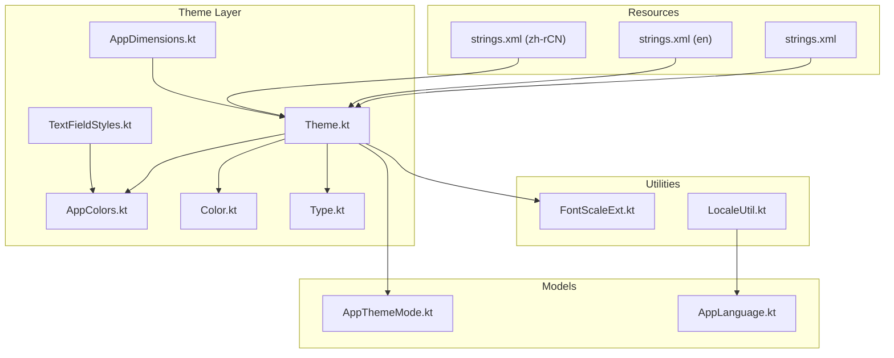
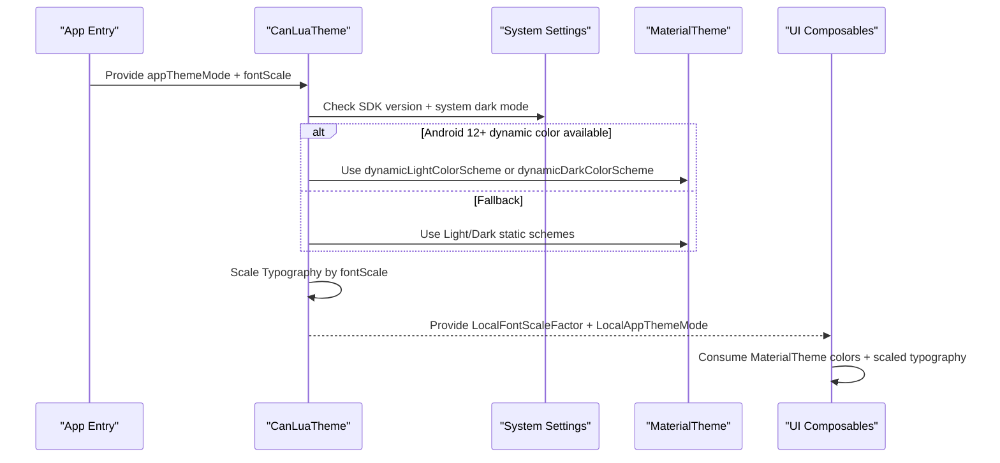
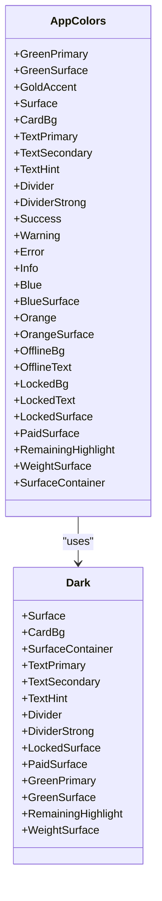
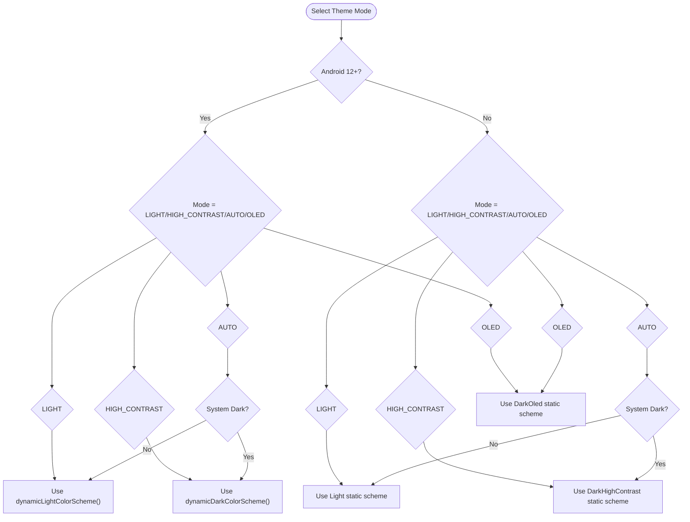
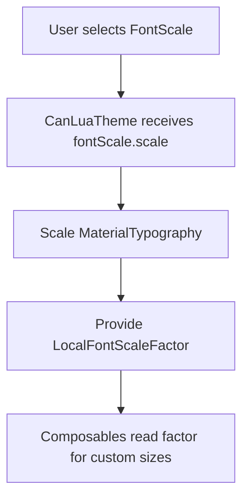
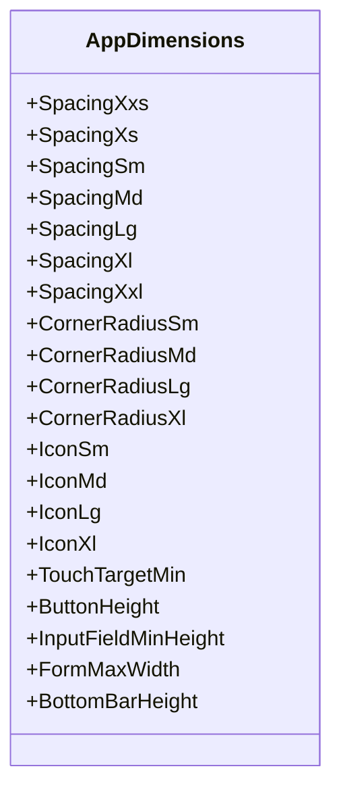
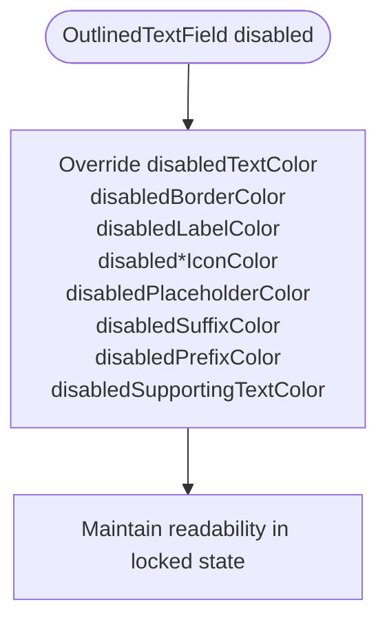
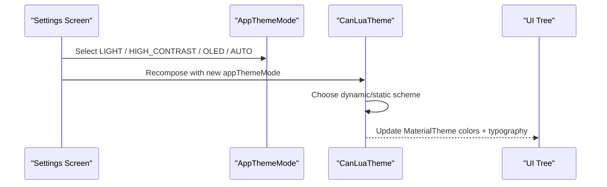
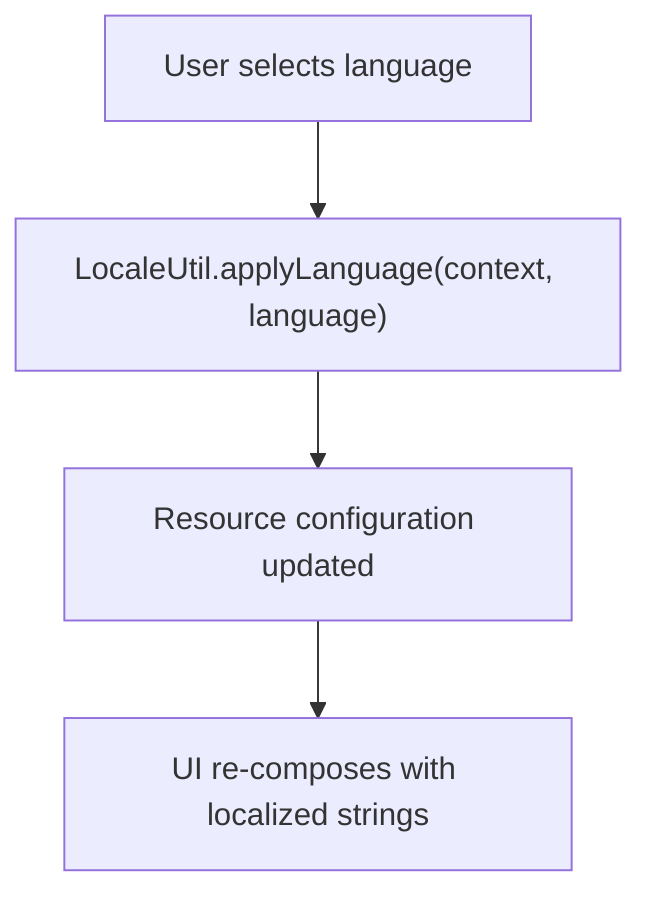
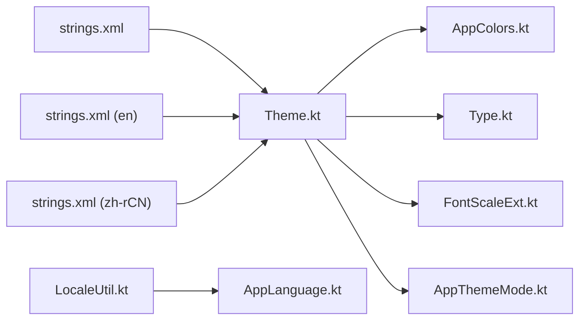

# Theming & Design System

<cite>
**Referenced Files in This Document**   
- [AppColors.kt](file://app/src/main/java/com/giathinh/canlua/ui/theme/AppColors.kt)
- [Theme.kt](file://app/src/main/java/com/giathinh/canlua/ui/theme/Theme.kt)
- [Color.kt](file://app/src/main/java/com/giathinh/canlua/ui/theme/Color.kt)
- [Type.kt](file://app/src/main/java/com/giathinh/canlua/ui/theme/Type.kt)
- [TextFieldStyles.kt](file://app/src/main/java/com/giathinh/canlua/ui/theme/TextFieldStyles.kt)
- [AppDimensions.kt](file://app/src/main/java/com/giathinh/canlua/ui/theme/AppDimensions.kt)
- [FontScaleExt.kt](file://app/src/main/java/com/giathinh/canlua/ui/util/FontScaleExt.kt)
- [AppThemeMode.kt](file://app/src/main/java/com/giathinh/canlua/data/model/AppThemeMode.kt)
- [AppLanguage.kt](file://app/src/main/java/com/giathinh/canlua/data/model/AppLanguage.kt)
- [LocaleUtil.kt](file://app/src/main/java/com/giathinh/canlua/util/LocaleUtil.kt)
- [strings.xml](file://app/src/main/res/values/strings.xml)
- [strings.xml (en)](file://app/src/main/res/values-en/strings.xml)
- [strings.xml (zh-rCN)](file://app/src/main/res/values-zh-rCN/strings.xml)
</cite>

## Table of Contents
1. [Introduction](#introduction)
2. [Project Structure](#project-structure)
3. [Core Components](#core-components)
4. [Architecture Overview](#architecture-overview)
5. [Detailed Component Analysis](#detailed-component-analysis)
6. [Dependency Analysis](#dependency-analysis)
7. [Performance Considerations](#performance-considerations)
8. [Troubleshooting Guide](#troubleshooting-guide)
9. [Conclusion](#conclusion)
10. [Appendices](#appendices)

## Introduction
This document explains Cân Lúa Mobile’s Material Design 3 theming system and design tokens. It covers the color palette with dynamic color support, semantic light/dark colors, agricultural-themed accents, typography scaling for accessibility, consistent spacing dimensions, custom text field styles, theme switching, adaptive layout considerations, and localization for Vietnamese, Khmer, Lao, and Chinese. It also provides guidelines for extending the design system while maintaining visual consistency and accessibility.

## Project Structure
The theming system is implemented under `ui/theme` with supporting utilities and data models:
- Color and semantic tokens: `AppColors`, `Color`, `Type`
- Theme orchestration and dynamic color selection: `Theme`
- Spacing and sizing tokens: `AppDimensions`
- Custom input styling: `TextFieldStyles`
- Font scale utility: `FontScaleExt`
- Theme mode model: `AppThemeMode`
- Language model and locale application: `AppLanguage`, `LocaleUtil`
- Localized strings: `values/strings.xml`, `values-en/strings.xml`, `values-zh-rCN/strings.xml`

**Diagram sources**
- [Theme.kt:23-120](file://app/src/main/java/com/giathinh/canlua/ui/theme/Theme.kt#L23-L120)
- [AppColors.kt:21-166](file://app/src/main/java/com/giathinh/canlua/ui/theme/AppColors.kt#L21-L166)
- [Color.kt:11-21](file://app/src/main/java/com/giathinh/canlua/ui/theme/Color.kt#L11-L21)
- [Type.kt:13-104](file://app/src/main/java/com/giathinh/canlua/ui/theme/Type.kt#L13-L104)
- [AppDimensions.kt:9-39](file://app/src/main/java/com/giathinh/canlua/ui/theme/AppDimensions.kt#L9-L39)
- [TextFieldStyles.kt:17-29](file://app/src/main/java/com/giathinh/canlua/ui/theme/TextFieldStyles.kt#L17-L29)
- [FontScaleExt.kt:18-27](file://app/src/main/java/com/giathinh/canlua/ui/util/FontScaleExt.kt#L18-L27)
- [AppThemeMode.kt:11-23](file://app/src/main/java/com/giathinh/canlua/data/model/AppThemeMode.kt#L11-L23)
- [AppLanguage.kt:6-22](file://app/src/main/java/com/giathinh/canlua/data/model/AppLanguage.kt#L6-L22)
- [LocaleUtil.kt:8-19](file://app/src/main/java/com/giathinh/canlua/util/LocaleUtil.kt#L8-L19)
- [strings.xml:344-352](file://app/src/main/res/values/strings.xml#L344-L352)
- [strings.xml (en):537-541](file://app/src/main/res/values-en/strings.xml#L537-L541)
- [strings.xml (zh-rCN):528-532](file://app/src/main/res/values-zh-rCN/strings.xml#L528-L532)

**Section sources**
- [Theme.kt:23-120](file://app/src/main/java/com/giathinh/canlua/ui/theme/Theme.kt#L23-L120)
- [AppColors.kt:21-166](file://app/src/main/java/com/giathinh/canlua/ui/theme/AppColors.kt#L21-L166)
- [Color.kt:11-21](file://app/src/main/java/com/giathinh/canlua/ui/theme/Color.kt#L11-L21)
- [Type.kt:13-104](file://app/src/main/java/com/giathinh/canlua/ui/theme/Type.kt#L13-L104)
- [AppDimensions.kt:9-39](file://app/src/main/java/com/giathinh/canlua/ui/theme/AppDimensions.kt#L9-L39)
- [TextFieldStyles.kt:17-29](file://app/src/main/java/com/giathinh/canlua/ui/theme/TextFieldStyles.kt#L17-L29)
- [FontScaleExt.kt:18-27](file://app/src/main/java/com/giathinh/canlua/ui/util/FontScaleExt.kt#L18-L27)
- [AppThemeMode.kt:11-23](file://app/src/main/java/com/giathinh/canlua/data/model/AppThemeMode.kt#L11-L23)
- [AppLanguage.kt:6-22](file://app/src/main/java/com/giathinh/canlua/data/model/AppLanguage.kt#L6-L22)
- [LocaleUtil.kt:8-19](file://app/src/main/java/com/giathinh/canlua/util/LocaleUtil.kt#L8-L19)
- [strings.xml:344-352](file://app/src/main/res/values/strings.xml#L344-L352)
- [strings.xml (en):537-541](file://app/src/main/res/values-en/strings.xml#L537-L541)
- [strings.xml (zh-rCN):528-532](file://app/src/main/res/values-zh-rCN/strings.xml#L528-L532)

## Core Components
- Color palette and semantic tokens: Agricultural green primary, golden accent, neutral surfaces, status colors, and dark-mode overrides.
- Dynamic color support: Uses Material You dynamic schemes when available; falls back to static schemes otherwise.
- Typography: Fluent-style type scale with accessibility-friendly sizes and line heights; scalable via user font size setting.
- Dimensions: Consistent 4dp-based spacing, corner radii, icon sizes, touch targets, and bottom navigation height.
- Text fields: Locked-aware disabled state colors to preserve readability outdoors.
- Theme modes: Light, High Contrast, OLED, and Auto (system).
- Localization: Vietnamese, English, Khmer, Lao, Chinese with per-app language support.

**Section sources**
- [AppColors.kt:21-166](file://app/src/main/java/com/giathinh/canlua/ui/theme/AppColors.kt#L21-L166)
- [Theme.kt:23-120](file://app/src/main/java/com/giathinh/canlua/ui/theme/Theme.kt#L23-L120)
- [Type.kt:13-104](file://app/src/main/java/com/giathinh/canlua/ui/theme/Type.kt#L13-L104)
- [AppDimensions.kt:9-39](file://app/src/main/java/com/giathinh/canlua/ui/theme/AppDimensions.kt#L9-L39)
- [TextFieldStyles.kt:17-29](file://app/src/main/java/com/giathinh/canlua/ui/theme/TextFieldStyles.kt#L17-L29)
- [AppThemeMode.kt:11-23](file://app/src/main/java/com/giathinh/canlua/data/model/AppThemeMode.kt#L11-L23)
- [AppLanguage.kt:6-22](file://app/src/main/java/com/giathinh/canlua/data/model/AppLanguage.kt#L6-L22)
- [LocaleUtil.kt:8-19](file://app/src/main/java/com/giathinh/canlua/util/LocaleUtil.kt#L8-L19)

## Architecture Overview
The theme root composable selects a color scheme based on the selected theme mode and system settings, applies dynamic colors when supported, scales typography according to user preference, and exposes composition locals for theme mode and font scale.

**Diagram sources**
- [Theme.kt:77-120](file://app/src/main/java/com/giathinh/canlua/ui/theme/Theme.kt#L77-L120)
- [Theme.kt:123-151](file://app/src/main/java/com/giathinh/canlua/ui/theme/Theme.kt#L123-L151)

**Section sources**
- [Theme.kt:77-151](file://app/src/main/java/com/giathinh/canlua/ui/theme/Theme.kt#L77-L151)

## Detailed Component Analysis

### Color Palette and Semantic Tokens
- Agricultural brand colors:
  - Green primary and surface tones for rice-field identity.
  - Gold accent for harvest highlights.
- Neutral tokens:
  - Surface, Card background, text roles (primary, secondary, hint), dividers (including strong variant for outdoor readability).
- Status tokens:
  - Success, Warning, Error, Info.
- Extended tokens:
  - Blue/Orange surfaces for badges and settings.
  - Offline, Locked, Paid surfaces for transaction states.
  - Detail screen surfaces: Remaining highlight, Weight surface, Surface container.
- Dark theme overrides:
  - Dedicated dark values for all semantic tokens to ensure contrast and hierarchy.

**Diagram sources**
- [AppColors.kt:21-166](file://app/src/main/java/com/giathinh/canlua/ui/theme/AppColors.kt#L21-L166)

**Section sources**
- [AppColors.kt:21-166](file://app/src/main/java/com/giathinh/canlua/ui/theme/AppColors.kt#L21-L166)

### Dynamic Color Support and Theme Modes
- Dynamic color:
  - On Android 12+, uses dynamic light/dark schemes based on wallpaper.
  - Falls back to static schemes on older versions.
- Theme modes:
  - LIGHT: Always light.
  - HIGH_CONTRAST: Dark high-contrast fallback.
  - OLED: Deep black backgrounds for OLED devices.
  - AUTO: Follows system light/dark.

**Diagram sources**
- [Theme.kt:23-107](file://app/src/main/java/com/giathinh/canlua/ui/theme/Theme.kt#L23-L107)
- [AppThemeMode.kt:11-23](file://app/src/main/java/com/giathinh/canlua/data/model/AppThemeMode.kt#L11-L23)

**Section sources**
- [Theme.kt:23-107](file://app/src/main/java/com/giathinh/canlua/ui/theme/Theme.kt#L23-L107)
- [AppThemeMode.kt:11-23](file://app/src/main/java/com/giathinh/canlua/data/model/AppThemeMode.kt#L11-L23)

### Typography and Accessibility Scaling
- Type scale:
  - Fluent-inspired sizes from displayLarge down to labelSmall.
  - Emphasis on legibility for outdoor use.
- Scalable typography:
  - User-selected font scale applied to MaterialTypography.
  - Extra helper for non-typography sizes via `LocalFontScaleFactor`.

**Diagram sources**
- [Theme.kt:109-151](file://app/src/main/java/com/giathinh/canlua/ui/theme/Theme.kt#L109-L151)
- [FontScaleExt.kt:18-27](file://app/src/main/java/com/giathinh/canlua/ui/util/FontScaleExt.kt#L18-L27)
- [Type.kt:13-104](file://app/src/main/java/com/giathinh/canlua/ui/theme/Type.kt#L13-L104)

**Section sources**
- [Type.kt:13-104](file://app/src/main/java/com/giathinh/canlua/ui/theme/Type.kt#L13-L104)
- [Theme.kt:109-151](file://app/src/main/java/com/giathinh/canlua/ui/theme/Theme.kt#L109-L151)
- [FontScaleExt.kt:18-27](file://app/src/main/java/com/giathinh/canlua/ui/util/FontScaleExt.kt#L18-L27)

### Dimension Tokens and Touch Targets
- Spacing scale: 4dp base increments (Xxs to Xxl).
- Corner radius scale: Sm to Xl.
- Icon sizes: Sm to Xl.
- Touch targets: Minimum 48dp; button and input field heights defined.
- Bottom navigation height token.

**Diagram sources**
- [AppDimensions.kt:9-39](file://app/src/main/java/com/giathinh/canlua/ui/theme/AppDimensions.kt#L9-L39)

**Section sources**
- [AppDimensions.kt:9-39](file://app/src/main/java/com/giathinh/canlua/ui/theme/AppDimensions.kt#L9-L39)

### Custom Text Field Styles for Readability
- Disabled state colors are overridden to keep text readable when a card is locked.
- Border, label, icons, placeholder, suffix/prefix, and supporting text retain appropriate contrast.

**Diagram sources**
- [TextFieldStyles.kt:17-29](file://app/src/main/java/com/giathinh/canlua/ui/theme/TextFieldStyles.kt#L17-L29)
- [AppColors.kt:54-83](file://app/src/main/java/com/giathinh/canlua/ui/theme/AppColors.kt#L54-L83)

**Section sources**
- [TextFieldStyles.kt:17-29](file://app/src/main/java/com/giathinh/canlua/ui/theme/TextFieldStyles.kt#L17-L29)
- [AppColors.kt:54-83](file://app/src/main/java/com/giathinh/canlua/ui/theme/AppColors.kt#L54-L83)

### Theme Switching Mechanism
- Theme mode enum maps to localized labels for settings.
- CanLuaTheme composable switches between dynamic/static schemes based on mode and system settings.
- Composition locals expose current theme mode and font scale to descendants.

**Diagram sources**
- [AppThemeMode.kt:11-23](file://app/src/main/java/com/giathinh/canlua/data/model/AppThemeMode.kt#L11-L23)
- [Theme.kt:77-120](file://app/src/main/java/com/giathinh/canlua/ui/theme/Theme.kt#L77-L120)

**Section sources**
- [AppThemeMode.kt:11-23](file://app/src/main/java/com/giathinh/canlua/data/model/AppThemeMode.kt#L11-L23)
- [Theme.kt:77-120](file://app/src/main/java/com/giathinh/canlua/ui/theme/Theme.kt#L77-L120)

### Adaptive Layouts for Different Screen Sizes
- The design system provides dimension tokens for spacing, corners, icons, and touch targets that can be reused across layouts.
- For responsive behavior, prefer using these tokens consistently and leverage Compose layout modifiers (e.g., padding, constraints) rather than hard-coded sizes.
- Ensure minimum touch target sizes (≥48dp) for usability on small screens.

[No sources needed since this section provides general guidance]

### Localization Support
- Supported languages: Vietnamese, English, Khmer, Lao, Chinese.
- Per-app language switching uses modern APIs without Activity restart on Android 13+.
- String resources include theme-related labels and language names.

**Diagram sources**
- [AppLanguage.kt:6-22](file://app/src/main/java/com/giathinh/canlua/data/model/AppLanguage.kt#L6-L22)
- [LocaleUtil.kt:8-19](file://app/src/main/java/com/giathinh/canlua/util/LocaleUtil.kt#L8-L19)
- [strings.xml:512-521](file://app/src/main/res/values/strings.xml#L512-L521)
- [strings.xml (en):471-480](file://app/src/main/res/values-en/strings.xml#L471-L480)
- [strings.xml (zh-rCN):462-471](file://app/src/main/res/values-zh-rCN/strings.xml#L462-L471)

**Section sources**
- [AppLanguage.kt:6-22](file://app/src/main/java/com/giathinh/canlua/data/model/AppLanguage.kt#L6-L22)
- [LocaleUtil.kt:8-19](file://app/src/main/java/com/giathinh/canlua/util/LocaleUtil.kt#L8-L19)
- [strings.xml:512-521](file://app/src/main/res/values/strings.xml#L512-L521)
- [strings.xml (en):471-480](file://app/src/main/res/values-en/strings.xml#L471-L480)
- [strings.xml (zh-rCN):462-471](file://app/src/main/res/values-zh-rCN/strings.xml#L462-L471)

### Extending the Design System
- Adding new colors:
  - Define semantic tokens in `AppColors` with both light and dark variants.
  - Prefer animated accessors for smooth transitions between themes.
- Adding new dimensions:
  - Extend `AppDimensions` following the 4dp grid and naming conventions.
- Adding new typography:
  - Add entries to the global `Typography` object if they represent distinct roles.
- Maintaining consistency:
  - Reuse tokens everywhere instead of hard-coding values.
  - Keep disabled states accessible (see TextFieldStyles pattern).

[No sources needed since this section provides general guidance]

### Accessibility Compliance and High Contrast
- High Contrast mode:
  - Dedicated dark high-contrast color scheme ensures stronger contrast ratios.
- Outdoor readability:
  - Stronger dividers and preserved disabled text colors improve legibility in bright conditions.
- Font scaling:
  - User-controlled font scale affects all typography and custom sizes via composition local.

**Section sources**
- [Theme.kt:40-55](file://app/src/main/java/com/giathinh/canlua/ui/theme/Theme.kt#L40-L55)
- [TextFieldStyles.kt:17-29](file://app/src/main/java/com/giathinh/canlua/ui/theme/TextFieldStyles.kt#L17-L29)
- [Theme.kt:109-151](file://app/src/main/java/com/giathinh/canlua/ui/theme/Theme.kt#L109-L151)

### RTL Layout Considerations
- The theming layer does not enforce directionality.
- For RTL support, ensure:
  - Use start/end layout properties instead of left/right.
  - Test alignment and icon mirroring for right-to-left locales.
  - Validate text flow and punctuation in localized strings.

[No sources needed since this section provides general guidance]

## Dependency Analysis

**Diagram sources**
- [Theme.kt:77-120](file://app/src/main/java/com/giathinh/canlua/ui/theme/Theme.kt#L77-L120)
- [AppColors.kt:21-166](file://app/src/main/java/com/giathinh/canlua/ui/theme/AppColors.kt#L21-L166)
- [Type.kt:13-104](file://app/src/main/java/com/giathinh/canlua/ui/theme/Type.kt#L13-L104)
- [FontScaleExt.kt:18-27](file://app/src/main/java/com/giathinh/canlua/ui/util/FontScaleExt.kt#L18-L27)
- [AppThemeMode.kt:11-23](file://app/src/main/java/com/giathinh/canlua/data/model/AppThemeMode.kt#L11-L23)
- [LocaleUtil.kt:8-19](file://app/src/main/java/com/giathinh/canlua/util/LocaleUtil.kt#L8-L19)
- [AppLanguage.kt:6-22](file://app/src/main/java/com/giathinh/canlua/data/model/AppLanguage.kt#L6-L22)
- [strings.xml:344-352](file://app/src/main/res/values/strings.xml#L344-L352)
- [strings.xml (en):537-541](file://app/src/main/res/values-en/strings.xml#L537-L541)
- [strings.xml (zh-rCN):528-532](file://app/src/main/res/values-zh-rCN/strings.xml#L528-L532)

**Section sources**
- [Theme.kt:77-120](file://app/src/main/java/com/giathinh/canlua/ui/theme/Theme.kt#L77-L120)
- [AppColors.kt:21-166](file://app/src/main/java/com/giathinh/canlua/ui/theme/AppColors.kt#L21-L166)
- [Type.kt:13-104](file://app/src/main/java/com/giathinh/canlua/ui/theme/Type.kt#L13-L104)
- [FontScaleExt.kt:18-27](file://app/src/main/java/com/giathinh/canlua/ui/util/FontScaleExt.kt#L18-L27)
- [AppThemeMode.kt:11-23](file://app/src/main/java/com/giathinh/canlua/data/model/AppThemeMode.kt#L11-L23)
- [LocaleUtil.kt:8-19](file://app/src/main/java/com/giathinh/canlua/util/LocaleUtil.kt#L8-L19)
- [AppLanguage.kt:6-22](file://app/src/main/java/com/giathinh/canlua/data/model/AppLanguage.kt#L6-L22)
- [strings.xml:344-352](file://app/src/main/res/values/strings.xml#L344-L352)
- [strings.xml (en):537-541](file://app/src/main/res/values-en/strings.xml#L537-L541)
- [strings.xml (zh-rCN):528-532](file://app/src/main/res/values-zh-rCN/strings.xml#L528-L532)

## Performance Considerations
- Animated color tokens:
  - Using animated color getters introduces recompositions during theme transitions; keep usage minimal and scoped to necessary components.
- Dynamic color:
  - Available only on Android 12+; fallback paths avoid runtime errors on older devices.
- Typography scaling:
  - Scaling occurs once at theme composition; downstream composables benefit without extra computation.

**Section sources**
- [AppColors.kt:21-166](file://app/src/main/java/com/giathinh/canlua/ui/theme/AppColors.kt#L21-L166)
- [Theme.kt:83-107](file://app/src/main/java/com/giathinh/canlua/ui/theme/Theme.kt#L83-L107)
- [Theme.kt:109-151](file://app/src/main/java/com/giathinh/canlua/ui/theme/Theme.kt#L109-L151)

## Troubleshooting Guide
- Theme appears inverted in AUTO mode:
  - Verify `isAppInDarkTheme` logic and ensure AUTO delegates to system dark mode.
- Colors look washed out in disabled inputs:
  - Use the locked-aware text field colors to maintain contrast.
- Dynamic color not applied:
  - Confirm device runs Android 12+ and dynamic color is enabled; fallback schemes should still work.
- Language change not reflected:
  - Ensure `LocaleUtil.applyLanguage` is called with the correct language tag.

**Section sources**
- [AppColors.kt:14-19](file://app/src/main/java/com/giathinh/canlua/ui/theme/AppColors.kt#L14-L19)
- [TextFieldStyles.kt:17-29](file://app/src/main/java/com/giathinh/canlua/ui/theme/TextFieldStyles.kt#L17-L29)
- [Theme.kt:83-107](file://app/src/main/java/com/giathinh/canlua/ui/theme/Theme.kt#L83-L107)
- [LocaleUtil.kt:8-19](file://app/src/main/java/com/giathinh/canlua/util/LocaleUtil.kt#L8-L19)

## Conclusion
Cân Lúa Mobile’s theming system centers on a clear set of agricultural-themed tokens, robust dynamic color support, accessible typography scaling, and consistent dimensions. The architecture cleanly separates concerns: theme orchestration, semantic colors, typography, and utilities. With proper extension practices and attention to accessibility and localization, the system remains maintainable and adaptable across devices and user preferences.

## Appendices

### Quick Reference: Theme Modes and Labels
- LIGHT: Light theme
- HIGH_CONTRAST: Dark high-contrast
- OLED: AMOLED black backgrounds
- AUTO: Follows system

**Section sources**
- [strings.xml:344-352](file://app/src/main/res/values/strings.xml#L344-L352)
- [strings.xml (en):537-541](file://app/src/main/res/values-en/strings.xml#L537-L541)
- [strings.xml (zh-rCN):528-532](file://app/src/main/res/values-zh-rCN/strings.xml#L528-L532)