# UI Components & Screens

<cite>
**Referenced Files in This Document**
- [MainActivity.kt](file://app/src/main/java/com/giathinh/canlua/MainActivity.kt)
- [MainScreen.kt](file://app/src/main/java/com/GiaThinh/canlua/ui/MainScreen.kt)
- [AppNavHost.kt](file://app/src/main/java/com/GiaThinh/canlua/ui/navigation/AppNavHost.kt)
- [BottomNavItem.kt](file://app/src/main/java/com/GiaThinh/canlua/ui/navigation/BottomNavItem.kt)
- [NavTransitions.kt](file://app/src/main/java/com/GiaThinh/canlua/ui/navigation/NavTransitions.kt)
- [Theme.kt](file://app/src/main/java/com/GiaThinh/canlua/ui/theme/Theme.kt)
- [TextFieldStyles.kt](file://app/src/main/java/com/GiaThinh/canlua/ui/theme/TextFieldStyles.kt)
- [AuthScreen.kt](file://app/src/main/java/com/GiaThinh/canlua/ui/screen/AuthScreen.kt)
- [FarmerProfileScreen.kt](file://app/src/main/java/com/GiaThinh/canlua/ui/screen/FarmerProfileScreen.kt)
- [TraderProfileScreen.kt](file://app/src/main/java/com/GiaThinh/canlua/ui/screen/trader/TraderProfileScreen.kt)
- [KpiGrid.kt](file://app/src/main/java/com/GiaThinh/canlua/ui/component/dashboard/KpiGrid.kt)
- [AppLanguage.kt](file://app/src/main/java/com/GiaThinh/canlua/data/model/AppLanguage.kt)
- [LocaleUtil.kt](file://app/src/main/java/com/GiaThinh/canlua/util/LocaleUtil.kt)
</cite>

## Table of Contents
1. [Introduction](#introduction)
2. [Project Structure](#project-structure)
3. [Core Components](#core-components)
4. [Architecture Overview](#architecture-overview)
5. [Detailed Component Analysis](#detailed-component-analysis)
6. [Dependency Analysis](#dependency-analysis)
7. [Performance Considerations](#performance-considerations)
8. [Troubleshooting Guide](#troubleshooting-guide)
9. [Conclusion](#conclusion)
10. [Appendices](#appendices)

## Introduction
This document explains the Jetpack Compose UI architecture for Cân Lúa Mobile, focusing on modern declarative screens, Material Design 3 theming, reusable dashboard and chart components, role-based navigation, deep linking, accessibility, localization, and performance practices. The app is an offline-first Android application built with Kotlin, MVVM, StateFlow, Room, Firebase Firestore, Supabase, WorkManager, and Compose Navigation. It serves three roles: FARMER, TRADER, and GUEST.

## Project Structure
The UI layer is organized into:
- Root entry point and root navigation (`MainActivity`)
- Main shell with top bar, bottom navigation, and content area (`MainScreen`)
- App-level NavHost for tabbed routes and sub-screens (`AppNavHost`)
- Theme system using Material Design 3 (`Theme`, `TextFieldStyles`)
- Role-specific profile screens (`FarmerProfileScreen`, `TraderProfileScreen`)
- Authentication screen (`AuthScreen`)
- Dashboard and chart components under `ui/component/dashboard`
- Localization model and utility (`AppLanguage`, `LocaleUtil`)

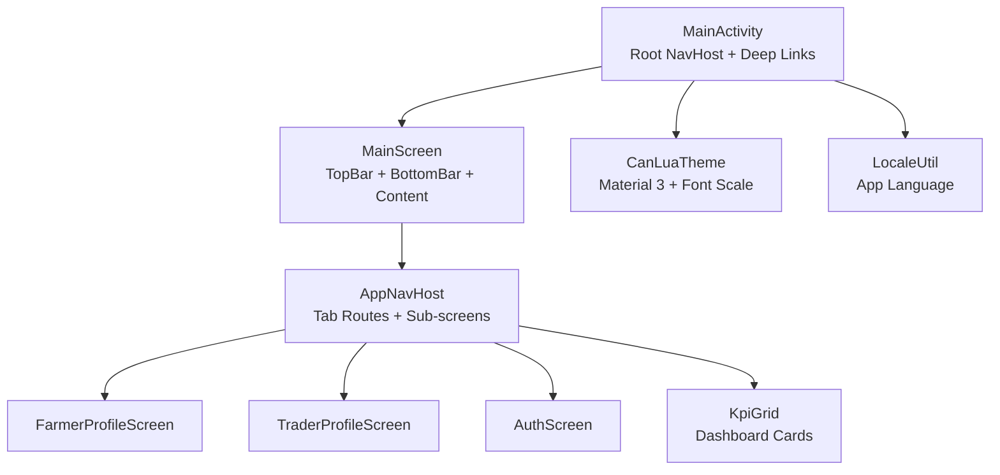

**Diagram sources**
- [MainActivity.kt:45-145](file://app/src/main/java/com/GiaThinh/canlua/MainActivity.kt#L45-L145)
- [MainScreen.kt:75-384](file://app/src/main/java/com/GiaThinh/canlua/ui/MainScreen.kt#L75-L384)
- [AppNavHost.kt:31-150](file://app/src/main/java/com/GiaThinh/canlua/ui/navigation/AppNavHost.kt#L31-L150)
- [Theme.kt:77-121](file://app/src/main/java/com/GiaThinh/canlua/ui/theme/Theme.kt#L77-L121)
- [LocaleUtil.kt:8-18](file://app/src/main/java/com/GiaThinh/canlua/util/LocaleUtil.kt#L8-L18)

**Section sources**
- [MainActivity.kt:45-145](file://app/src/main/java/com/GiaThinh/canlua/MainActivity.kt#L45-L145)
- [MainScreen.kt:75-384](file://app/src/main/java/com/GiaThinh/canlua/ui/MainScreen.kt#L75-L384)
- [AppNavHost.kt:31-150](file://app/src/main/java/com/GiaThinh/canlua/ui/navigation/AppNavHost.kt#L31-L150)

## Core Components
- **Root Navigation**: Handles splash, login, profile setup, and main shell routing; supports deep links to card detail via share URLs.
- **Main Shell**: Provides a responsive Scaffold with dynamic top bar behavior, offline banner, and adaptive bottom navigation based on user role.
- **App Navigation Host**: Centralizes tab routes (Scale, Market, AI Chat, Account/Trader Profile) and sub-routes (details, settings, sync status, premium, deleted cards, trader transactions).
- **Theme System**: Applies Material 3 color schemes, dynamic colors on supported devices, and scalable typography through font scale.
- **Localization**: Supports Vietnamese, English, Khmer, Lao, and Chinese via resource configuration and runtime language switching.
- **Role-Aware Profiles**: Renders farmer or trader dashboards with shared dashboard components and role-specific metrics.

**Section sources**
- [MainActivity.kt:34-145](file://app/src/main/java/com/GiaThinh/canlua/MainActivity.kt#L34-L145)
- [MainScreen.kt:75-384](file://app/src/main/java/com/GiaThinh/canlua/ui/MainScreen.kt#L75-L384)
- [AppNavHost.kt:31-150](file://app/src/main/java/com/GiaThinh/canlua/ui/navigation/AppNavHost.kt#L31-L150)
- [Theme.kt:77-151](file://app/src/main/java/com/GiaThinh/canlua/ui/theme/Theme.kt#L77-L151)
- [AppLanguage.kt:6-22](file://app/src/main/java/com/GiaThinh/canlua/data/model/AppLanguage.kt#L6-L22)
- [LocaleUtil.kt:8-18](file://app/src/main/java/com/GiaThinh/canlua/util/LocaleUtil.kt#L8-L18)

## Architecture Overview
The UI follows a layered approach:
- Activity level composes theme, locale, and root navigation.
- MainScreen manages shell chrome and delegates content to AppNavHost.
- AppNavHost defines tab routes and pushes sub-screens.
- Role-aware wrappers select between farmer and trader profiles.
- Dashboard components are reused across both profiles.

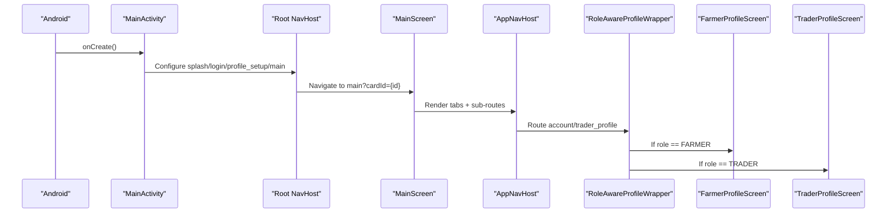

**Diagram sources**
- [MainActivity.kt:45-145](file://app/src/main/java/com/GiaThinh/canlua/MainActivity.kt#L45-L145)
- [MainScreen.kt:75-384](file://app/src/main/java/com/GiaThinh/canlua/ui/MainScreen.kt#L75-L384)
- [AppNavHost.kt:31-150](file://app/src/main/java/com/GiaThinh/canlua/ui/navigation/AppNavHost.kt#L31-L150)

## Detailed Component Analysis

### Root Navigation and Deep Linking
- Splash, login, profile setup, and main shell are defined at the root NavHost.
- Deep links open the main shell and forward to card detail with the provided card ID.
- Guest mode bypasses authentication and navigates directly to the main shell.

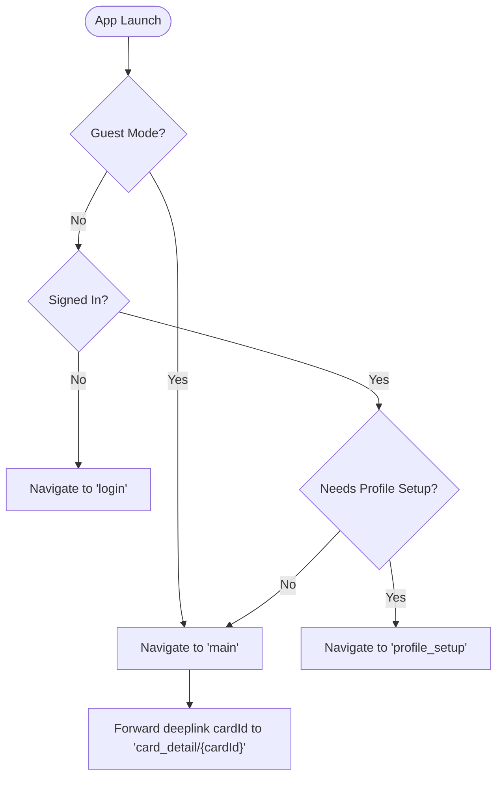

**Diagram sources**
- [MainActivity.kt:45-145](file://app/src/main/java/com/GiaThinh/canlua/MainActivity.kt#L45-L145)
- [AppNavHost.kt:31-44](file://app/src/main/java/com/GiaThinh/canlua/ui/navigation/AppNavHost.kt#L31-L44)

**Section sources**
- [MainActivity.kt:34-145](file://app/src/main/java/com/GiaThinh/canlua/MainActivity.kt#L34-L145)
- [AppNavHost.kt:31-44](file://app/src/main/java/com/GiaThinh/canlua/ui/navigation/AppNavHost.kt#L31-L44)

### Main Shell and Adaptive Layouts
- Top bar adapts per route: pinned vs enterAlways scroll behavior, contextual icons, and subtitles.
- Bottom navigation switches between farmer and trader items based on profile role.
- Offline banner reflects connectivity state; keyboard visibility hides bottom bar when needed.

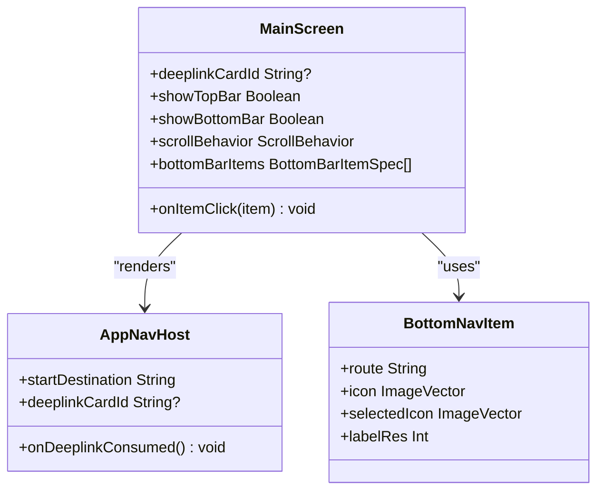

**Diagram sources**
- [MainScreen.kt:75-384](file://app/src/main/java/com/GiaThinh/canlua/ui/MainScreen.kt#L75-L384)
- [AppNavHost.kt:31-150](file://app/src/main/java/com/GiaThinh/canlua/ui/navigation/AppNavHost.kt#L31-L150)
- [BottomNavItem.kt:25-70](file://app/src/main/java/com/GiaThinh/canlua/ui/navigation/BottomNavItem.kt#L25-L70)

**Section sources**
- [MainScreen.kt:75-384](file://app/src/main/java/com/GiaThinh/canlua/ui/MainScreen.kt#L75-L384)
- [BottomNavItem.kt:25-70](file://app/src/main/java/com/GiaThinh/canlua/ui/navigation/BottomNavItem.kt#L25-L70)

### Navigation Transitions
- Default transitions use fade + scale for all composables inside AppNavHost.
- Tab-aware slide transitions provide consistent directionality for tab-to-tab navigation and sub-screen push/pop.

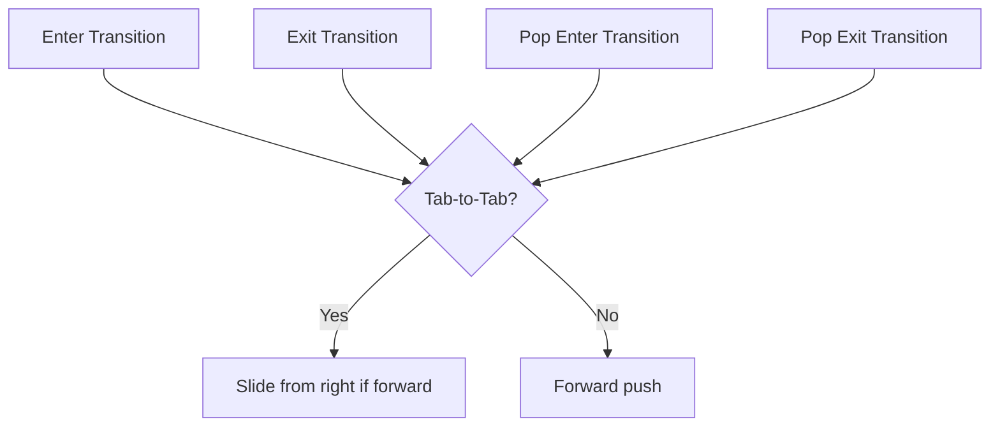

**Diagram sources**
- [NavTransitions.kt:13-110](file://app/src/main/java/com/GiaThinh/canlua/ui/navigation/NavTransitions.kt#L13-L110)
- [AppNavHost.kt:45-55](file://app/src/main/java/com/GiaThinh/canlua/ui/navigation/AppNavHost.kt#L45-L55)

**Section sources**
- [NavTransitions.kt:13-110](file://app/src/main/java/com/GiaThinh/canlua/ui/navigation/NavTransitions.kt#L13-L110)
- [AppNavHost.kt:45-55](file://app/src/main/java/com/GiaThinh/canlua/ui/navigation/AppNavHost.kt#L45-L55)

### Theming and Accessibility
- Material 3 color schemes adapt to light/dark/OLED/high contrast modes.
- Dynamic colors are used on supported Android versions; otherwise fallback schemes apply.
- Typography scales globally via font scale composition local.
- TextField styles override disabled token colors to maintain readability for locked fields.

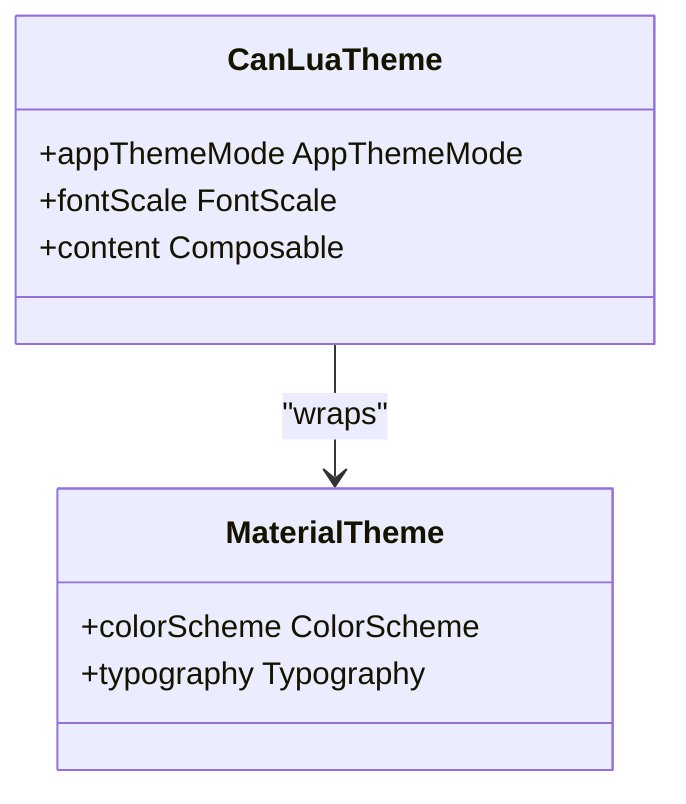

**Diagram sources**
- [Theme.kt:77-151](file://app/src/main/java/com/GiaThinh/canlua/ui/theme/Theme.kt#L77-L151)
- [TextFieldStyles.kt:18-29](file://app/src/main/java/com/GiaThinh/canlua/ui/theme/TextFieldStyles.kt#L18-L29)

**Section sources**
- [Theme.kt:77-151](file://app/src/main/java/com/GiaThinh/canlua/ui/theme/Theme.kt#L77-L151)
- [TextFieldStyles.kt:18-29](file://app/src/main/java/com/GiaThinh/canlua/ui/theme/TextFieldStyles.kt#L18-L29)

### Localization Support
- Supported languages: Vietnamese, English, Khmer, Lao, Chinese.
- Runtime language changes apply via AppCompatDelegate with per-app locales.
- Resources are localized under values directories for each language.

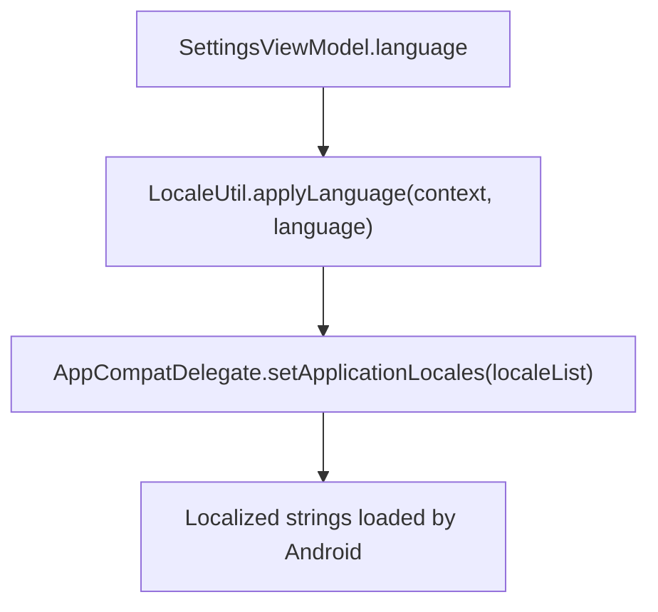

**Diagram sources**
- [AppLanguage.kt:6-22](file://app/src/main/java/com/GiaThinh/canlua/data/model/AppLanguage.kt#L6-L22)
- [LocaleUtil.kt:8-18](file://app/src/main/java/com/GiaThinh/canlua/util/LocaleUtil.kt#L8-L18)

**Section sources**
- [AppLanguage.kt:6-22](file://app/src/main/java/com/GiaThinh/canlua/data/model/AppLanguage.kt#L6-L22)
- [LocaleUtil.kt:8-18](file://app/src/main/java/com/GiaThinh/canlua/util/LocaleUtil.kt#L8-L18)

### Reusable UI Components

#### Dashboard Cards and Charts
- KpiGrid renders two-column rows of KpiCard with optional delta indicators and highlight semantics.
- Shared dashboard components include season comparison charts, variety pie charts, and AI insights cards.

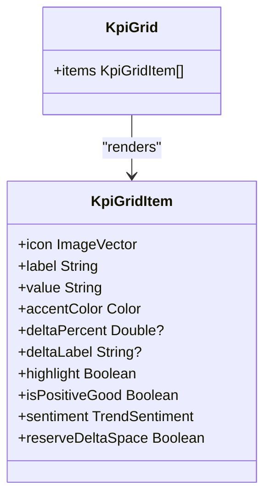

**Diagram sources**
- [KpiGrid.kt:15-67](file://app/src/main/java/com/GiaThinh/canlua/ui/component/dashboard/KpiGrid.kt#L15-L67)

**Section sources**
- [KpiGrid.kt:15-67](file://app/src/main/java/com/GiaThinh/canlua/ui/component/dashboard/KpiGrid.kt#L15-L67)

#### Form Inputs and Validation
- AuthScreen provides email/password and phone OTP flows with validation and haptic feedback.
- Semantics and keyboard options improve accessibility and input experience.

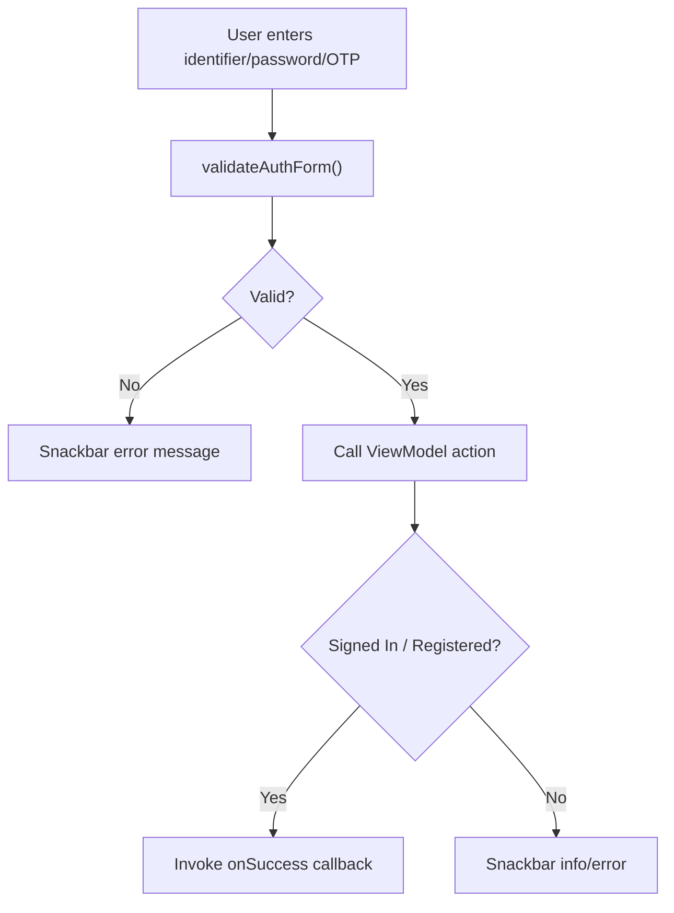

**Diagram sources**
- [AuthScreen.kt:387-682](file://app/src/main/java/com/GiaThinh/canlua/ui/screen/AuthScreen.kt#L387-L682)
- [AuthScreen.kt:744-755](file://app/src/main/java/com/GiaThinh/canlua/ui/screen/AuthScreen.kt#L744-L755)

**Section sources**
- [AuthScreen.kt:387-682](file://app/src/main/java/com/GiaThinh/canlua/ui/screen/AuthScreen.kt#L387-L682)
- [AuthScreen.kt:744-755](file://app/src/main/java/com/GiaThinh/canlua/ui/screen/AuthScreen.kt#L744-L755)

### Screen Implementations

#### Farmer Portal
- Presents a tiered layout: hero header, quick stats, season selector, primary KPI grid, secondary stats, season comparison chart, AI insights, season summary, and premium promotion.
- Uses combined dashboard data to avoid flow avalanche and reduce recompositions.

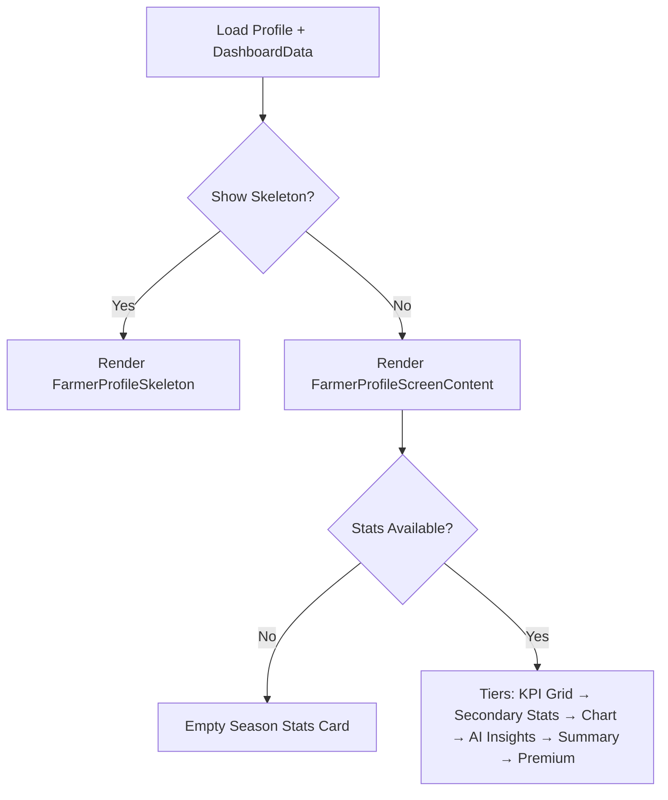

**Diagram sources**
- [FarmerProfileScreen.kt:86-279](file://app/src/main/java/com/GiaThinh/canlua/ui/screen/FarmerProfileScreen.kt#L86-L279)

**Section sources**
- [FarmerProfileScreen.kt:86-279](file://app/src/main/java/com/GiaThinh/canlua/ui/screen/FarmerProfileScreen.kt#L86-L279)

#### Trader Interface
- Mirrors farmer structure with trader-specific metrics: purchased yield, paid amount, supplier debt, slip count, and variety pie chart.
- Includes transaction ledger navigation and premium promotion.

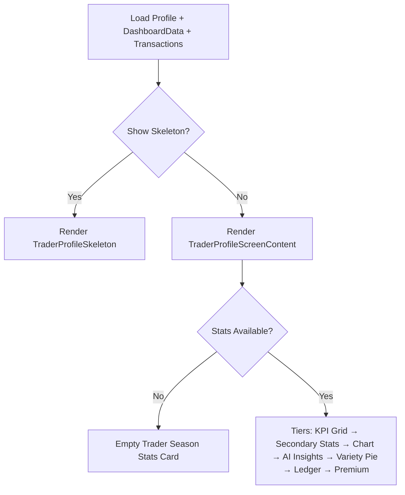

**Diagram sources**
- [TraderProfileScreen.kt:88-336](file://app/src/main/java/com/GiaThinh/canlua/ui/screen/trader/TraderProfileScreen.kt#L88-L336)

**Section sources**
- [TraderProfileScreen.kt:88-336](file://app/src/main/java/com/GiaThinh/canlua/ui/screen/trader/TraderProfileScreen.kt#L88-L336)

#### Guest Experience
- Guest mode bypasses authentication and navigates directly to the main shell.
- Profile screens show guest login promotion cards encouraging sign-in.

**Section sources**
- [MainActivity.kt:64-108](file://app/src/main/java/com/GiaThinh/canlua/MainActivity.kt#L64-L108)
- [FarmerProfileScreen.kt:162-169](file://app/src/main/java/com/GiaThinh/canlua/ui/screen/FarmerProfileScreen.kt#L162-L169)
- [TraderProfileScreen.kt:172-182](file://app/src/main/java/com/GiaThinh/canlua/ui/screen/trader/TraderProfileScreen.kt#L172-L182)

## Dependency Analysis
- MainActivity depends on InitViewModel, AuthViewModel, SettingsViewModel, and LocaleUtil.
- MainScreen depends on AppNavHost, BottomNavItem, and various view models for settings and feedback.
- AppNavHost composes multiple screens and uses RoleAwareProfileWrapper to select between farmer and trader profiles.
- Theme and localization utilities are applied at the root level and consumed throughout the UI tree.

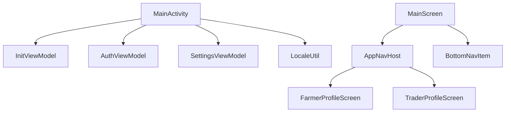

**Diagram sources**
- [MainActivity.kt:45-145](file://app/src/main/java/com/GiaThinh/canlua/MainActivity.kt#L45-L145)
- [MainScreen.kt:75-384](file://app/src/main/java/com/GiaThinh/canlua/ui/MainScreen.kt#L75-L384)
- [AppNavHost.kt:31-150](file://app/src/main/java/com/GiaThinh/canlua/ui/navigation/AppNavHost.kt#L31-L150)

**Section sources**
- [MainActivity.kt:45-145](file://app/src/main/java/com/GiaThinh/canlua/MainActivity.kt#L45-L145)
- [MainScreen.kt:75-384](file://app/src/main/java/com/GiaThinh/canlua/ui/MainScreen.kt#L75-L384)
- [AppNavHost.kt:31-150](file://app/src/main/java/com/GiaThinh/canlua/ui/navigation/AppNavHost.kt#L31-L150)

## Performance Considerations
- Use combined dashboard data to minimize recompositions and avoid flow avalanche.
- Prefer remember and derivedStateOf for stable references and computed values.
- Keep animations lightweight: fade/scale transitions and spring-based bottom bar animations.
- Avoid recreating scroll behaviors on every recomposition; cache them with remember.
- Monitor network state efficiently and update UI only when necessary.

[No sources needed since this section provides general guidance]

## Troubleshooting Guide
- Deep link not opening card detail: ensure the main route includes deepLinks and that AppNavHost forwards the cardId to card_detail.
- Bottom bar flickering: verify scroll behavior is remembered and not recreated on recomposition.
- Keyboard overlapping bottom bar: confirm imePadding and visibility logic hide the bottom bar when IME is visible.
- Localization not applying: check LocaleUtil.applyLanguage is called with the correct AppLanguage tag and resources exist for the target language.

**Section sources**
- [MainActivity.kt:132-141](file://app/src/main/java/com/GiaThinh/canlua/MainActivity.kt#L132-L141)
- [MainScreen.kt:155-163](file://app/src/main/java/com/GiaThinh/canlua/ui/MainScreen.kt#L155-L163)
- [LocaleUtil.kt:8-18](file://app/src/main/java/com/GiaThinh/canlua/util/LocaleUtil.kt#L8-L18)

## Conclusion
Cân Lúa Mobile’s UI architecture leverages Compose Navigation, Material Design 3 theming, and role-aware screens to deliver a responsive, accessible, and localized experience. Reusable dashboard components and charts support both farmer and trader workflows, while deep linking and adaptive layouts enhance usability across devices and contexts. Following the patterns outlined here will help maintain consistency, performance, and clarity as new screens and components are added.

[No sources needed since this section summarizes without analyzing specific files]

## Appendices

### Guidelines for Creating New Screens
- Add a route in AppNavHost and compose the screen with appropriate navController usage.
- Use role-aware wrappers where necessary to render different UIs for farmers and traders.
- Follow the tiered layout pattern for profile screens: header, stats, charts, insights, and operations.
- Integrate with existing view models and dashboard data to avoid redundant state management.

**Section sources**
- [AppNavHost.kt:56-136](file://app/src/main/java/com/GiaThinh/canlua/ui/navigation/AppNavHost.kt#L56-L136)
- [FarmerProfileScreen.kt:86-279](file://app/src/main/java/com/GiaThinh/canlua/ui/screen/FarmerProfileScreen.kt#L86-L279)
- [TraderProfileScreen.kt:88-336](file://app/src/main/java/com/GiaThinh/canlua/ui/screen/trader/TraderProfileScreen.kt#L88-L336)

### Guidelines for Implementing Custom Components
- Use Material 3 primitives and theme tokens for consistency.
- Provide semantic descriptions for accessibility.
- Keep animations subtle and aligned with M3 motion guidelines.
- Test edge cases such as empty states, loading states, and invalid inputs.

**Section sources**
- [Theme.kt:77-151](file://app/src/main/java/com/GiaThinh/canlua/ui/theme/Theme.kt#L77-L151)
- [TextFieldStyles.kt:18-29](file://app/src/main/java/com/GiaThinh/canlua/ui/theme/TextFieldStyles.kt#L18-L29)
- [AuthScreen.kt:387-682](file://app/src/main/java/com/GiaThinh/canlua/ui/screen/AuthScreen.kt#L387-L682)