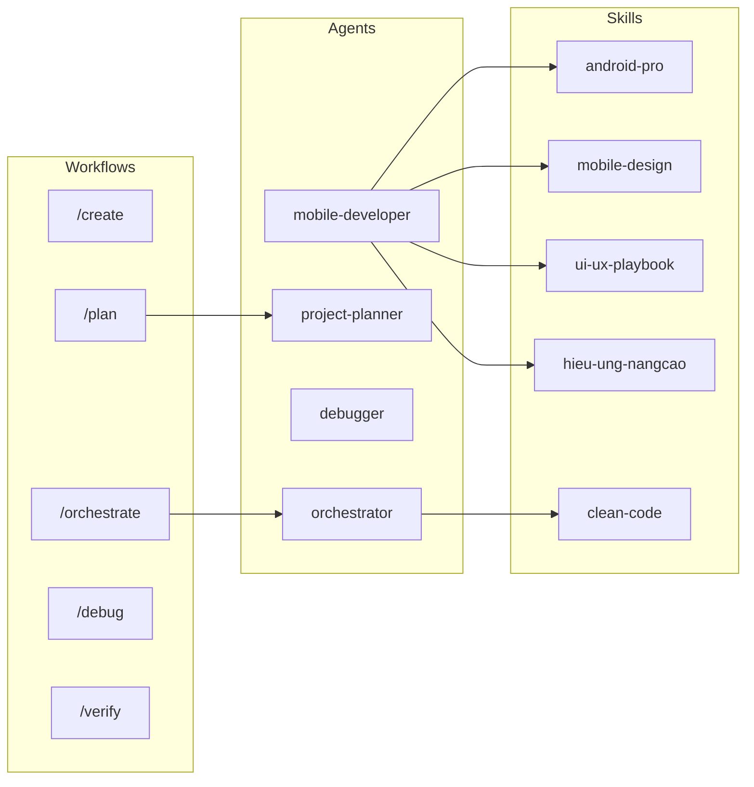

<!-- Language Switcher: [English](#english) | [Tiếng Việt](#tiếng-việt) -->

<div align="right">
  <a href="#english">🇺🇸 English</a> &nbsp;|&nbsp;
  <a href="#tiếng-việt">🇻🇳 Tiếng Việt</a>
</div>

---

<a name="english"></a>

# 🌾 Cân Lúa Mobile

> **Next-Generation Smart Agricultural Weighing & Season Management Application for the Mekong Delta.**  
> *100% Offline-First · Multi-Role (Farmer & Trader & Guest) · Gemini RAG AI · Realtime Cloud Sync · Field Ergonomics.*

[](https://developer.android.com)
[](https://kotlinlang.org)
[](https://developer.android.com/jetpack/compose)
[](https://m3.material.io)
[-orange)](https://developer.android.com/training/data-storage/room)
[](https://dagger.dev/hilt/)
[-teal)](#internationalization-i18n)
[-black)](#-ag-kit-architecture--dependency-graph)

---

## 🌟 Overview & Core Philosophy

**Cân Lúa Mobile** is engineered from the ground up for the harsh, unpredictable conditions of the Mekong Delta fields. Whether in scorching heat, rain, or remote paddies with zero cellular connectivity, every single interaction is instantaneous, reliable, and ergonomic.

1. **True Offline-First Architecture**: Powered by Room SQLite v18 with full local persistence. Data is recorded instantly on-device, then automatically bidirectional-synced to Firebase Firestore & Supabase via WorkManager once network connectivity resumes.
2. **Multi-Role System**:
   - 👨‍🌾 **Farmer (`FARMER`)**: Rapid multi-bag weighing, automatic deduction formulas, season yield & revenue KPI dashboards, Gemini AI agronomy advisor.
   - 💼 **Trader (`TRADER`)**: Season purchase ledger, realtime transaction books (`TraderTransactionsScreen`), quick call/Zalo counterparty contact sheet (`TraderHistoryScreen`), public rice bid price management, supply hotspot map (`RiceMapScreen`).
   - 👤 **Guest Mode (`GUEST`)**: Zero-friction onboarding — access all core weighing, PDF receipt generation, and price lookup features without mandatory account creation.
3. **Field Ergonomics & Sensory Feedback**:
   - All interactive touch targets strictly meet or exceed **$\ge 48\text{dp}$** (number keypad keys $\ge 56\text{dp}$).
   - Low-latency haptic feedback via `HapticUtil.tick(context)` on every keypad press, toggle, and action row.
   - Strict adherence to `DESIGN.md` and the **Purple Ban** (organic agricultural palette: `GreenPrimary`, `GoldDark`, `SurfaceContainer`).
4. **Complete 19-Screen Certified Audit**: 100% of the screen inventory is thoroughly audited, standardized, and synchronized across 5 locales.

---

## 🛠️ Technology Stack

| Layer | Technology & Version | Key Purpose |
| :--- | :--- | :--- |
| **Language & Tooling** | Kotlin `2.3.0` · KSP `2.3.9` · AGP `9.1.1` | Modern, type-safe, compiled runtime |
| **Target Platforms** | Android SDK `37` (minSdk `24`, targetSdk `37`) | Covers 95%+ Android devices in rural areas |
| **UI Framework** | Jetpack Compose BOM `2026.06.00` · Material 3 `1.4.0` | Declarative UI, dynamic theming, smooth spring animations |
| **Architecture** | MVVM + Clean Architecture + Reactive Coroutines/Flow | Unidirectional Data Flow (`StateFlow` + Lifecycle-aware) |
| **Dependency Injection** | Dagger Hilt `2.59.2` + Hilt Navigation Compose `1.3.0` | Compile-time dependency graph injection |
| **Local Persistence** | AndroidX Room `2.8.4` (DB schema v18, 8 entities) | Robust migration chain, SQLite ACID compliance |
| **Cloud & Backend** | Firebase BOM `34.15.0` (Auth, Firestore, Crashlytics, Perf) + Supabase | Realtime cloud backup, authentication, and telemetry |
| **Background Sync** | AndroidX WorkManager `2.11.2` + Hilt Work `1.3.0` | Idempotent background cloud synchronization |
| **Maps & Geo** | Google Maps Compose `8.3.0` + Marker Clustering | Field GPS coordinates capture and density visualization |
| **Charts & Visualization** | Vico Compose `3.2.2` | 7-day rice price trendline and seasonal yield comparisons |
| **AI Engine (RAG)** | OpenRouter (Gemini Flash) with live market context | Agronomy disease diagnosis, harvest tips, season insights |
| **Voice & Speech** | Android Text-To-Speech (TTS) + Speech Recognizer (STT) | Audio readout during weighing; voice prompt inputs |
| **Document Export** | Custom Vector/Canvas PDF Exporter (`PdfExporter`) | Receipts with SHA-256 integrity hash and dual signatures |
| **Networking** | OkHttp `5.4.0` + Gson `2.14.0` | Fast RSS news feeds, OpenWeatherMap weather advisory |
| **Security** | AndroidX Security Crypto `1.1.0` | EncryptedSharedPreferences for API keys and tokens |

---

## 🌾 Key Application Features

### 1. Smart Field Weighing Keypad
- **Auto-jumping decimal input**: Typing `503` automatically resolves to `50.3 kg`; `1503` resolves to `150.3 kg`.
- **Audio feedback (TTS)**: Reads out weights aloud so farmers don't need to stare at the screen under bright sunlight.
- **Slip locking mechanism**: Locks finalized cards to prevent accidental tampering after settlement.

### 2. Flexible Tare & Impurity Deduction Formulas
- **Bag Tare Modes**:
  - *Unit Ratio*: Every $X$ bags deducts 1 kg tare ($W_{\text{tare}} = N_{\text{bags}} / X$).
  - *Sample Tare*: Weigh $X$ sample bags to get $Y$ kg tare ($W_{\text{tare}} = N_{\text{bags}} \times \frac{Y}{X}$).
- **Impurity Modes**: Deduct by percentage after tare, or deduct exact kilograms directly.
- **Moisture Deduction**: Proportional calculation based on standard moisture thresholds.

### 3. Multi-Role Portals
- **Farmer Portal**: Crop season summary (Total kg, Bag count, Revenue, Average price), seasonal comparison charts, AI Insights.
- **Trader Portal**: Purchase transaction ledger (`TraderTransactionsScreen`), trader contact book with 1-tap Phone/Zalo integration (`TraderHistoryScreen`), public buying price publisher (`MarketBidEditorSheet`).

### 4. Google Maps & Market Intelligence
- **Purchase GPS Clustering**: Automatic GPS coordinate stamping for every weigh card created in the paddy.
- **Market Price Board**: Live prices across Mekong Delta provinces, 7-day trend charts, and RSS agricultural news.

### 5. RAG Agricultural AI Assistant (Gemini Flash)
- OpenRouter API integration loaded with current rice market rates, paddy diseases (blast, brown planthopper), and variety care sheets (ST25, OM5451, Dai Thom 8).

### 6. Data Safety & Recycle Bin
- **Recycle Bin (`DeletedCardsScreen`)**: Safely restore accidentally deleted weigh cards or purge permanently.
- **JSON Backup & Restore**: Offline export and restore of weighing datasets.

---

## 📐 Net Weight & Financial Formulas

$$\begin{aligned}
W_{\text{tare}} &= \begin{cases} 
\frac{N_{\text{bags}}}{X_{\text{unit}}} & \text{(Unit Bag Mode)} \\[6pt]
N_{\text{bags}} \times \left( \frac{Y_{\text{sample}}}{X_{\text{sample}}} \right) & \text{(Sample Bag Mode)}
\end{cases} \\[10pt]
W_{\text{net}} &= W_{\text{gross}} - W_{\text{tare}} - W_{\text{impurity}} - \left( W_{\text{gross}} \times \frac{M_{\%}}{100} \right) \\[10pt]
\text{Total Amount} &= W_{\text{net}} \times \text{Unit Price} \\[6pt]
\text{Remaining Due} &= \text{Total Amount} - \text{Deposit} - \text{Paid}
\end{aligned}$$

---

## 📱 19-Screen System Inventory

| # | Screen | Kotlin File | Role | Highlights |
| :-: | :--- | :--- | :-: | :--- |
| **01** | Card Detail | `ui/screen/CardDetailScreen.kt` | Core | PDF export, Lock slip, Share, Haptics |
| **02** | Card List (Home) | `ui/screen/CardListScreen.kt` | Core | Date filter chips, Search, KPI card, Empty state |
| **03** | News Section | `ui/component/market/NewsSection.kt` | Nav 2 | Pull-to-refresh, RSS categorization, relative time |
| **04** | Market Prices | `ui/screen/market/MarketScreen.kt` | Nav 2 | Live price board, Bid publisher sheet, Vico trend chart |
| **05** | Weight Input | `ui/screen/WeightInputScreen.kt` | Core | $\ge 56\text{dp}$ keypad, TTS audio readout, auto-jump |
| **06** | AI Chat | `ui/screen/aichat/AiChatScreen.kt` | Nav 3 | Preset queries, Gemini RAG, STT voice input, tier table |
| **07** | Farmer Profile | `ui/screen/FarmerProfileScreen.kt` | Nav 4 | Season stats, AI Insights card, role switch dialog |
| **08** | Trader Profile | `ui/screen/trader/TraderProfileScreen.kt` | Nav 4 | Purchase ledger stats, variety breakdown |
| **09** | Rice Map | `ui/screen/map/RiceMapScreen.kt` | Trader | Maps Compose, Marker clustering, BottomSheet |
| **10** | Premium Upgrade | `ui/screen/profile/PremiumScreen.kt` | Monetization | 3 subscription plans, Early Adopter promo, benefits list |
| **11** | App Settings | `ui/screen/SettingsScreen.kt` | Settings | 5-language selector, JSON backup/restore, logout |
| **12** | Trader Transactions | `ui/screen/trader/TraderTransactionsScreen.kt` | Trader | Time filter chips, unpaid debt tracker |
| **13** | Trader History | `ui/screen/TraderHistoryScreen.kt` | Trader | Counterparty directory, 1-tap Call & Zalo triggers |
| **14** | Deleted Cards | `ui/screen/DeletedCardsScreen.kt` | Data | Soft delete recovery, permanent purge with confirm dialog |
| **15** | User Feedback | `ui/screen/profile/FeedbackScreen.kt` | Support | Developer message form, feedback history list |
| **16** | Cloud Sync Status | `ui/screen/SyncStatusScreen.kt` | Cloud | Realtime sync state, manual trigger button ($52\text{dp}$) |
| **17** | Authentication | `ui/screen/AuthScreen.kt` | Onboarding | Google Sign-In, Phone OTP, Email, Guest bypass |
| **18** | Profile Setup | `ui/screen/ProfileSetupScreen.kt` | Onboarding | Role selector cards ($140\text{dp}$), custom token styling |
| **19** | Splash Screen | `ui/screen/AppSplashScreen.kt` | Splash | Agricultural green gradient, pulsing logo, localized slogan |

---

## 🌐 Internationalization (i18n)

The application provides first-class support for **5 languages**, localized across all screens, buttons, placeholders, dialogs, and status banners:

| Code | Language | Native Name | File Path |
| :---: | :--- | :--- | :--- |
| `vi` | **Vietnamese** (Default) | Tiếng Việt | `app/src/main/res/values/strings.xml` |
| `en` | **English** | English | `app/src/main/res/values-en/strings.xml` |
| `km` | **Khmer** | ភាសាខ្មែរ | `app/src/main/res/values-km/strings.xml` |
| `lo` | **Lao** | ພາສາລາວ | `app/src/main/res/values-lo/strings.xml` |
| `zh-rCN` | **Chinese (Simplified)** | 中文 (简体) | `app/src/main/res/values-zh-rCN/strings.xml` |

---

## 🤖 AG Kit Architecture & Dependency Graph

The project is developed and maintained in synergy with the **AG Kit 2026.7.18** intelligence system (`.agents/`), providing **22 Specialist Agents**, **53 Domain Skills**, and **13 Automation Workflows**.

### Generating & Verifying the Dependency Graph

The project includes the automated Python script [`dependency_graph.py`](.agents/scripts/dependency_graph.py) that reads component metadata from `.agents/manifest.json` and produces a maintainable Mermaid dependency graph at [`.agents/DEPENDENCY_GRAPH.md`](.agents/DEPENDENCY_GRAPH.md):

```bash
# 1. Regenerate dependency graph
python .agents/scripts/dependency_graph.py

# 2. Check for dependency graph drift (fails if out of sync)
python .agents/scripts/dependency_graph.py --check

# 3. Validate entire AG Kit toolkit
python .agents/scripts/validate_kit.py
```



---

## 🚀 Setup & Build Instructions

### Prerequisites
- **JDK 17** or **JDK 21**
- **Android Studio Ladybug (2024.2+)** or **Antigravity IDE**
- Android SDK Platform 37 installed

### 1. Configure `local.properties`
Create or edit `local.properties` in the root directory:

```properties
sdk.dir=C:\\Users\\<Username>\\AppData\\Local\\Android\\Sdk
MAPS_API_KEY=your_google_maps_api_key
OPENROUTER_API_KEY=your_openrouter_gemini_api_key
OPENWEATHER_API_KEY=your_openweather_api_key
APP_HANDSHAKE_TOKEN=your_secure_handshake_token
TELEGRAM_BOT_TOKEN=optional_bot_token
TELEGRAM_ADMIN_CHAT_ID=optional_chat_id
SUPABASE_URL=optional_supabase_url
SUPABASE_ANON_KEY=optional_supabase_anon_key
```

### 2. Add Firebase Configuration
Place your `google-services.json` file inside the `app/` directory:
```
d:/APP/appCanLua/app/google-services.json
```

### 3. Compile & Run
```powershell
# Compile Kotlin and verify resources
.\gradlew.bat compileDebugKotlin

# Build debug APK
.\gradlew.bat assembleDebug

# Install on connected device/emulator
.\gradlew.bat installDebug
```

---

## 📂 Project Directory Structure

```plaintext
appCanLua/
├── .agents/                               # AG Kit: 22 Agents, 53 Skills, 13 Workflows
│   ├── agent/                             # Specialist agent personas
│   ├── skills/                            # Domain skills (android-pro, mobile-design, etc.)
│   ├── workflows/                         # Slash commands (/plan, /orchestrate, /verify, ...)
│   ├── scripts/                           # Runtime utilities (dependency_graph.py, validate_kit.py)
│   └── DEPENDENCY_GRAPH.md                # Automated Mermaid dependency graph
├── app/
│   ├── src/main/
│   │   ├── java/com/giathinh/canlua/
│   │   │   ├── CanLuaApplication.kt       # Application class (Hilt, Firebase, OpenWeather init)
│   │   │   ├── MainActivity.kt            # Single Activity Compose entry point & navigation
│   │   │   ├── ads/                       # Google AdMob & UMP consent management
│   │   │   ├── auth/                      # GoogleSignInHelper & Firebase Auth wrapper
│   │   │   ├── data/
│   │   │   │   ├── database/              # AppDatabase (Room v18, 8 entities, migration chain)
│   │   │   │   ├── dao/                   # CardDao, WeightDao, ProfileDao, RicePriceDao, ...
│   │   │   │   ├── model/                 # Local Entities & Firestore DTO models
│   │   │   │   ├── converter/             # Room TypeConverters (Date, List)
│   │   │   │   └── remote/                # OpenRouter API, WeatherService, Supabase, RSS Parser
│   │   │   ├── di/                        # Hilt Modules (App, Database, Network, Firebase)
│   │   │   ├── repository/                # Card, Weight, Market, AI, Weather, Sync Repositories
│   │   │   ├── ui/
│   │   │   │   ├── screen/                # 19 Compose Screens (Weight, Market, AI, Profile, Map...)
│   │   │   │   │   ├── aichat/            # AiChatScreen.kt
│   │   │   │   │   ├── map/               # RiceMapScreen, MapFilters, CardSummaryBottomSheet
│   │   │   │   │   ├── market/            # MarketScreen, RicePriceCard, PriceTrendChart
│   │   │   │   │   ├── profile/           # PremiumScreen, FeedbackScreen, ProfileComponents
│   │   │   │   │   └── trader/            # TraderProfileScreen, TraderTransactionsScreen
│   │   │   │   ├── component/             # Reusable UI widgets (CardItem, CreateCardDialog, BottomBar)
│   │   │   │   ├── viewmodel/             # MVVM state holders (Card, Weight, AI, Market, Sync, Auth)
│   │   │   │   └── theme/                 # AppColors tokens, Typography, Material 3 Theme
│   │   │   └── util/                      # RiceCalculator, HapticUtil, PdfExporter, Formatters
│   │   └── res/
│   │       ├── values/strings.xml         # Tiếng Việt (Default)
│   │       ├── values-en/strings.xml      # English
│   │       ├── values-km/strings.xml      # ភាសាខ្មែរ (Khmer)
│   │       ├── values-lo/strings.xml      # ພາສາລາວ (Lao)
│   │       └── values-zh-rCN/strings.xml  # 中文 (Chinese Simplified)
│   └── build.gradle.kts                   # App-level build config (SDK 37, Compose, Hilt)
├── gradle/libs.versions.toml              # Version Catalog (Kotlin 2.3.0, Compose BOM 2026.06)
├── app-screens-checklist.md               # Master UI/UX & 19-Screen Audit Checklist
├── DESIGN.md                              # Design System tokens & Purple Ban specifications
└── README.md                              # Bilingual Master Documentation
```

---

<a name="tiếng-việt"></a>

# 🌾 Cân Lúa Mobile (Tiếng Việt)

> **Ứng dụng Cân Lúa & Quản Lý Mùa Vụ Nông Nghiệp Thông Minh Thế Hệ Mới Dành Cho Đồng Bằng Sông Cửu Long.**  
> *Hoạt động 100% Ngoại Tuyến (Offline-First) · Đa Vai Trò (Nông Dân & Thương Lái & Khách) · Trợ Lý AI Gemini RAG · Đồng Bộ Đám Mây Realtime · Công Thái Học Thực Địa.*

---

## 🌟 Tôn Chỉ & Triết Lý Thiết Kế

**Cân Lúa Mobile** được thiết kế chuyên biệt để vượt qua mọi thử thách khắc nghiệt ngoài ruộng lúa: nắng gắt, mưa gió, mạng chập chờn hoặc hoàn toàn mất sóng:

1. **Kiến Trúc Ngoại Tuyến (Offline-First)**:
   - Dữ liệu lưu tức thời vào cơ sở dữ liệu Room SQLite v18 trên máy mà không cần chờ mạng.
   - Khi có kết nối Internet, WorkManager tự động kích hoạt đồng bộ 2 chiều lên Firebase Firestore và Supabase.
2. **Hệ Thống Đa Vai Trò Linh Hoạt**:
   - 👨‍🌾 **Nông Dân (`FARMER`)**: Cân từng bao lúa ngoài đồng, tự động trừ bao bì/tạp chất/độ ẩm, xem bảng thống kê sản lượng và doanh thu từng vụ, tham vấn Trợ lý AI khuyến nông.
   - 💼 **Thương Lái (`TRADER`)**: Sổ thu mua mùa vụ, quản lý sổ giao dịch thời gian thực (`TraderTransactionsScreen`), danh bạ đối tác liên hệ nhanh 1 chạm Gọi điện/Zalo (`TraderHistoryScreen`), đăng bảng giá thu mua công khai, xem bản đồ nguồn cung lúa (`RiceMapScreen`).
   - 👤 **Chế Độ Khách (`GUEST`)**: Không bắt buộc tạo tài khoản — bà con và thương lái có thể vào dùng ngay đầy đủ tính năng cân, tính tiền, in PDF và xem giá cả.
3. **Công Thái Học Thực Địa & Phản Hồi Xúc Giác**:
   - Mọi nút bấm, icon và hàng tương tác đều đạt chuẩn kích thước chạm **$\ge 48\text{dp}$** (phím số cân lúa $\ge 56\text{dp}$).
   - Rung phản hồi nhẹ `HapticUtil.tick(context)` trên từng lượt bấm phím số và thao tác quan trọng.
   - Tuân thủ quy chuẩn `DESIGN.md` và **Purple Ban** (sử dụng hệ màu xanh lá nông nghiệp `GreenPrimary`, vàng hạt lúa `GoldDark`, nền kem `SurfaceContainer`).
4. **Hệ Thống 19 Màn Hình Đã Hoàn Thiện 100%**: Đạt chuẩn toàn diện về i18n 5 ngôn ngữ, 4 trạng thái giao diện (Loading, Empty, Error, Content) và biên dịch kiểm tra thành công.

---

## 🛠️ Ngăn Xếp Công Nghệ (Tech Stack)

| Tầng kiến trúc | Công nghệ & Phiên bản | Vai trò & Mục đích |
| :--- | :--- | :--- |
| **Ngôn ngữ & Công cụ** | Kotlin `2.3.0` · KSP `2.3.9` · AGP `9.1.1` | Nền tảng lập trình hiện đại, an toàn kiểu dữ liệu |
| **Hệ điều hành mục tiêu** | Android SDK `37` (minSdk `24`, targetSdk `37`) | Hỗ trợ 95%+ các dòng điện thoại phổ biến ở nông thôn |
| **Giao diện người dùng** | Jetpack Compose BOM `2026.06.00` · Material 3 `1.4.0` | UI khai báo, animation vật lý mượt mà, theme chuẩn token |
| **Kiến trúc phần mềm** | MVVM + Clean Architecture + Coroutines/StateFlow | Quản lý luồng dữ liệu 1 chiều, tách biệt UI và logic |
| **Dependency Injection** | Dagger Hilt `2.59.2` + Hilt Navigation Compose `1.3.0` | Quản lý vòng đời và tiêm phụ thuộc tự động |
| **Cơ sở dữ liệu cục bộ** | AndroidX Room `2.8.4` (Schema v18, 8 entities) | Lưu trữ SQLite bền vững, chuỗi migration an toàn |
| **Đám mây & Backend** | Firebase BOM `34.15.0` (Auth, Firestore, Crashlytics, Perf) + Supabase | Đồng bộ thời gian thực, quản lý định danh và giám sát hiệu năng |
| **Tác vụ nền** | AndroidX WorkManager `2.11.2` + Hilt Work `1.3.0` | Đồng bộ dữ liệu định kỳ và tự thử lại khi có mạng |
| **Bản đồ & Định vị** | Google Maps Compose `8.3.0` + Marker Clustering | Tự động ghi nhận GPS ruộng lúa, hiển thị mật độ thu mua |
| **Biểu đồ thị trường** | Vico Compose `3.2.2` | Biểu đồ xu hướng giá 7 ngày, so sánh các vụ mùa |
| **Trí tuệ nhân tạo (AI)** | OpenRouter (Gemini Flash) kết hợp RAG | Tư vấn bệnh lúa (đạo ôn, rầy nâu), phân bón ST25 |
| **Giọng nói & Âm thanh** | Android Text-To-Speech (TTS) + Speech Recognizer (STT) | Đọc số ký tự động khi cân; nhập câu hỏi bằng giọng nói |
| **Xuất tài liệu PDF** | Bộ xuất PDF đồ họa Vector tùy biến (`PdfExporter`) | In phiếu cân chuẩn, mã xác thực SHA-256, chữ ký 2 bên |
| **Mạng & Tin tức** | OkHttp `5.4.0` + Gson `2.14.0` | Nạp tin tức RSS nông nghiệp, thời tiết OpenWeatherMap |
| **Bảo mật** | AndroidX Security Crypto `1.1.0` | Mã hóa khóa API trong EncryptedSharedPreferences |

---

## 🌾 Tính Năng Nổi Bật

### 1. Bàn Phím Cân Lúa Tự Động Nhảy Ô
- **Nhập liệu siêu tốc**: Nhập `503` tự động chuyển thành `50.3 kg`, `1503` thành `150.3 kg`.
- **Đọc số bằng giọng nói (TTS)**: Phát âm thanh số cân giúp bà con không cần nhìn chằm chằm vào màn hình dưới trời nắng.
- **Khóa phiếu an toàn**: Chốt số liệu chống bấm nhầm sau khi đã thanh toán tiền lúa.

### 2. Quy Cách Trừ Bì & Tạp Chất Đa Dạng
- **Trừ bao bì**:
  - *Bao đơn vị*: Quy đổi $X$ bao = 1 kg bì ($W_{\text{bì}} = \text{Số bao} / X$).
  - *Cân mẫu*: Cân $X$ bao mẫu ra $Y$ kg bì ($W_{\text{bì}} = \text{Số bao} \times \frac{Y}{X}$).
- **Trừ tạp chất**: Trừ theo % sau khi trừ bao bì, hoặc trừ trực tiếp số kg tạp chất.
- **Trừ độ ẩm**: Tự động tính khấu hao theo tỷ lệ % độ ẩm thực tế.

### 3. Phân Hệ Đa Vai Trò (Nông Dân & Thương Lái)
- **Dành cho Nông Dân**: Thống kê sản lượng mùa vụ, so sánh doanh thu các vụ, Trợ lý AI phân tích số liệu mùa vụ.
- **Dành cho Thương Lái**: Sổ thu mua vụ, sổ giao dịch (`TraderTransactionsScreen`), danh bạ thương lái gọi điện/nhắn Zalo 1 chạm (`TraderHistoryScreen`), bảng đăng giá thu mua (`MarketBidEditorSheet`).

### 4. Bản Đồ Thu Mua & Bảng Giá Thị Trường
- **Bản đồ gom cụm GPS (Clustering)**: Lưu vị trí GPS thực tế ngoài đồng của từng phiếu cân.
- **Bảng giá thị trường**: Cập nhật giá lúa gạo ĐBSCL thời gian thực từ Firestore và biểu đồ xu hướng 7 ngày.

### 5. Trợ Lý Khuyến Nông Gemini RAG
- Tích hợp OpenRouter Gemini Flash kết hợp dữ liệu giá thị trường và tài liệu kỹ thuật nông nghiệp ĐBSCL.

### 6. Thùng Rác & Sao Lưu Dữ Liệu
- **Thùng rác (`DeletedCardsScreen`)**: Khôi phục phiếu cân lỡ tay xóa nhầm hoặc xóa vĩnh viễn an toàn.
- **Sao lưu JSON**: Xuất và khôi phục dữ liệu cân ra tệp JSON.

---

## 📐 Công Thức Tính Khối Lượng Thực & Tiền Bạc

$$\begin{aligned}
\text{KL Bì} &= \begin{cases} 
\frac{\text{Tổng số bao}}{X_{\text{đơn vị}}} & \text{(Quy cách Bao Đơn Vị)} \\[6pt]
\text{Tổng số bao} \times \left( \frac{Y_{\text{mẫu}}}{X_{\text{mẫu}}} \right) & \text{(Quy cách Cân Mẫu)}
\end{cases} \\[10pt]
\text{KL Thực} &= \text{KL Thô} - \text{KL Bì} - \text{Tạp Chất (kg)} - \left( \text{KL Thô} \times \frac{\text{Độ Ẩm \%}}{100} \right) \\[10pt]
\text{Thành Tiền} &= \text{KL Thực} \times \text{Đơn Giá (đ/kg)} \\[6pt]
\text{Còn Lại} &= \text{Thành Tiền} - \text{Tiền Cọc} - \text{Đã Thanh Toán}
\end{aligned}$$

---

## 🌐 Hệ Thống Đa Ngôn Ngữ (i18n 5 Ngôn Ngữ)

Toàn bộ ứng dụng được bản địa hóa 100% qua 5 ngôn ngữ trong thư mục tài nguyên:

- 🇻🇳 **Tiếng Việt**: `app/src/main/res/values/strings.xml`
- 🇬🇧 **English**: `app/src/main/res/values-en/strings.xml`
- 🇰🇭 **ភាសាខ្មែរ (Khmer)**: `app/src/main/res/values-km/strings.xml`
- 🇱🇦 **ພາສາລາວ (Lao)**: `app/src/main/res/values-lo/strings.xml`
- 🇨🇳 **中文 (Chinese Simplified)**: `app/src/main/res/values-zh-rCN/strings.xml`

---

## 🤖 Kiến Trúc AG Kit & Đồ Thị Phụ Thuộc (Dependency Graph)

Dự án được hỗ trợ bởi hệ sinh thái thông minh **AG Kit 2026.7.18** (`.agents/`), gồm **22 Chuyên Gia AI (Agents)**, **53 Kỹ Năng Chuyên Sâu (Skills)** và **13 Quy Trình Tự Động (Workflows)**.

### Tạo & Kiểm Thử Đồ Thị Phụ Thuộc

Dự án tích hợp script Python chuẩn hóa [`dependency_graph.py`](.agents/scripts/dependency_graph.py) để tự động sinh đồ thị Mermaid tại [`.agents/DEPENDENCY_GRAPH.md`](.agents/DEPENDENCY_GRAPH.md):

```bash
# 1. Tự động sinh đồ thị phụ thuộc
python .agents/scripts/dependency_graph.py

# 2. Kiểm tra tính đồng bộ của đồ thị phụ thuộc
python .agents/scripts/dependency_graph.py --check

# 3. Tự động kiểm thử toàn bộ tính hợp lệ của bộ công cụ AG Kit
python .agents/scripts/validate_kit.py
```

---

## 🚀 Hướng Dẫn Cài Đặt & Biên Dịch

### 1. Cấu hình tệp `local.properties`
Tạo hoặc mở tệp `local.properties` tại thư mục gốc:

```properties
sdk.dir=C:\\Users\\<TênUser>\\AppData\\Local\\Android\\Sdk
MAPS_API_KEY=khoa_api_google_maps_cua_ban
OPENROUTER_API_KEY=khoa_api_openrouter_cua_ban
OPENWEATHER_API_KEY=khoa_api_openweather_cua_ban
APP_HANDSHAKE_TOKEN=khoa_token_handshake
TELEGRAM_BOT_TOKEN=token_bot_neu_co
TELEGRAM_ADMIN_CHAT_ID=id_chat_admin_neu_co
SUPABASE_URL=url_supabase_neu_co
SUPABASE_ANON_KEY=key_supabase_neu_co
```

### 2. Thêm tệp cấu hình Firebase
Đặt tệp `google-services.json` vào thư mục `app/`:
```
d:/APP/appCanLua/app/google-services.json
```

### 3. Lệnh Biên Dịch & Chạy Thử
```powershell
# Kiểm tra biên dịch Kotlin và tài nguyên
.\gradlew.bat compileDebugKotlin

# Đóng gói bộ cài đặt APK Debug
.\gradlew.bat assembleDebug

# Cài đặt trực tiếp lên thiết bị/máy ảo
.\gradlew.bat installDebug
```

---

*Phát triển và bảo trì bởi Gia Thịnh · Bản quyền © 2026 Cân Lúa Mobile.*
